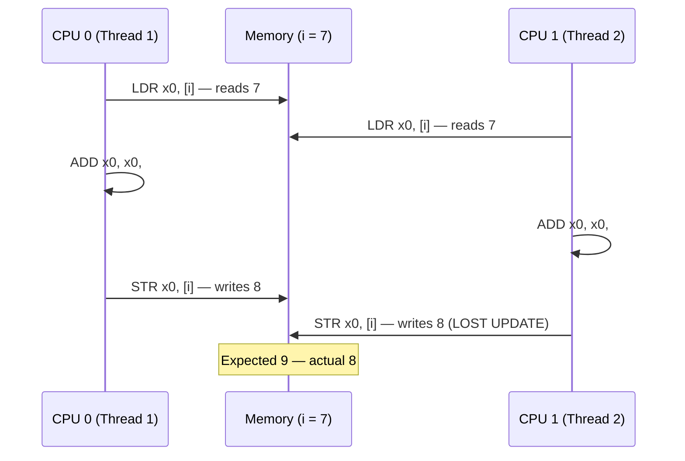
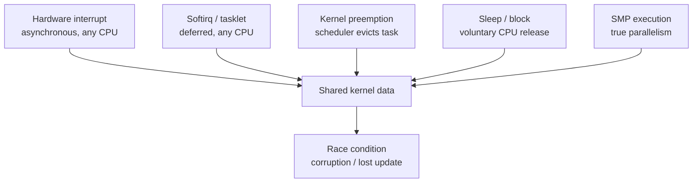
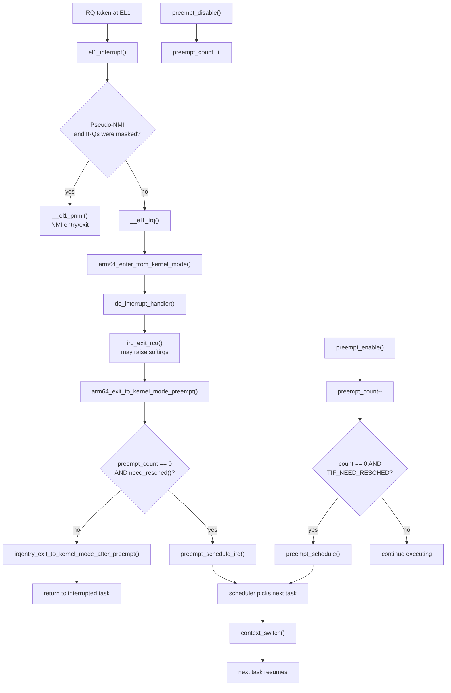
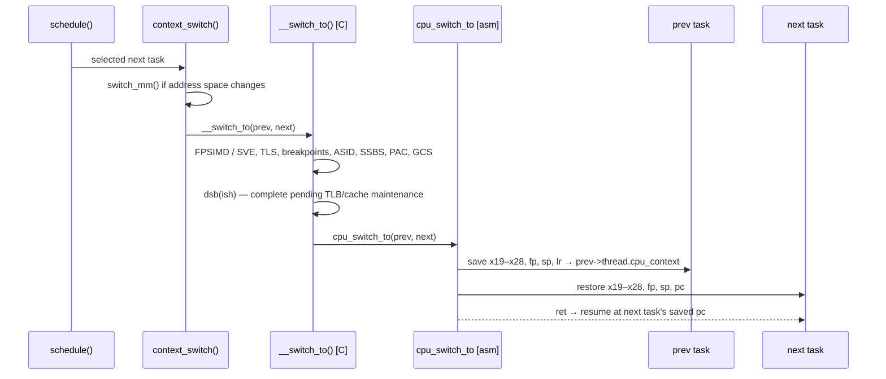
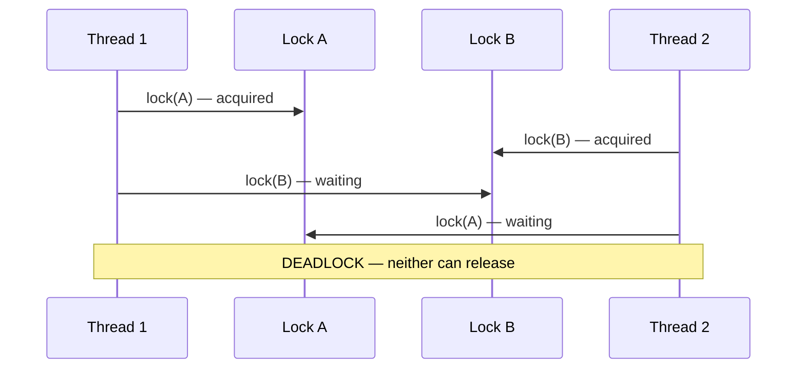
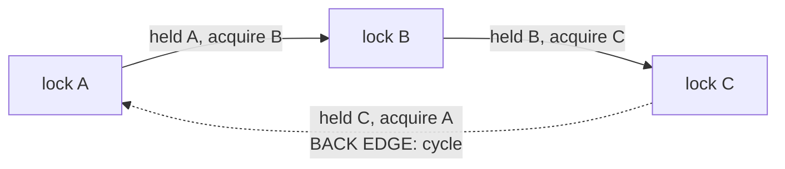

# Kernel Concurrency

The Linux kernel is not a single sequential program — it is a collection of overlapping execution paths: system calls from user processes, interrupt handlers firing asynchronously, softirqs deferred from interrupt context, kernel threads, and the scheduler itself. On a multiprocessor AArch64 system, several of these paths are literally executing simultaneously on separate cores, each with its own register file and pipeline, all sharing a single coherent view of DRAM.

```text
  user process ──► syscall ──┐
                             │
  hardware IRQ ──────────────┼──►  shared kernel data  ──►  corruption
  softirq / tasklet ─────────┤       (global state)         if unsynchronized
  kernel thread ─────────────┤
  scheduler ─────────────────┘
```

Every piece of global or shared kernel state is therefore subject to corruption the moment two paths touch it without coordination. Getting synchronization right is not an afterthought — it must be designed in from the start, because retrofitting locking into existing kernel code is difficult, fragile, and rarely pretty.

---

## Table of Contents

1. [Critical Regions and Race Conditions](#critical-regions-and-race-conditions)
2. [Concurrency, SMP, and the Linux Execution Model](#concurrency-smp-and-the-linux-execution-model)
3. [Causes of Concurrency in the Kernel](#causes-of-concurrency-in-the-kernel)
4. [Preemption: The preempt\_count Mechanism](#preemption-the-preempt_count-mechanism)
5. [Context Switch on AArch64](#context-switch-on-aarch64)
6. [Motivation for a Preemptible Kernel and CONFIG Options](#motivation-for-a-preemptible-kernel-and-config-options)
7. [What Needs Locking — Identifying Critical Regions](#what-needs-locking--identifying-critical-regions)
8. [Solutions to Concurrency and Their Limits](#solutions-to-concurrency-and-their-limits)
9. [Deadlocks and Lock Ordering](#deadlocks-and-lock-ordering)
10. [Lock Contention and Scalability](#lock-contention-and-scalability)
11. [Memory Ordering and Barriers on AArch64](#memory-ordering-and-barriers-on-aarch64)
12. [lockdep and CONFIG\_PROVE\_LOCKING](#lockdep-and-config_prove_locking)
13. [PREEMPT\_RT: The Real-Time Kernel](#preempt_rt-the-real-time-kernel)

---

## Critical Regions and Race Conditions

Code that accesses shared mutable state is called a **critical region** (or **critical section**). The requirement is that at most one thread of execution is inside the critical region at any given instant. When that requirement is violated — when two threads are executing within the same critical region simultaneously, or interleaving non-atomically — the result is a **race condition**.

The textbook illustration is a bank account withdrawal. Suppose two ATM transactions execute concurrently against an account holding $105: one withdraws $100, the other deducts a $10 fee. Each checks the balance independently, finds $105 is sufficient, and proceeds. The $100 withdrawal subtracts and writes back $5. The $10 fee transaction, working from the $105 it read before the first write landed, subtracts and writes back $95. The account now shows $95 — $110 has been dispensed from a $105 balance.

```text
  Time   ATM A ($100 withdrawal)        ATM B ($10 fee)               Balance
  ────   ───────────────────────        ────────────────              ───────
    1    read balance ─────────────────────────────────────────────►  105
    2                                  read balance ───────────────►  105
    3    write 105 - 100 = 5 ──────────────────────────────────────►    5
    4                                  write 105 - 10 = 95 ────────►   95

         Both transactions read the same stale value. One update is lost.
```

This is not a theoretical concern; it is a direct analogue of bugs that appear in kernel subsystems whenever a read-modify-write sequence on shared state is non-atomic.

The simplest computing instance is a counter increment. On AArch64, `i++` on a shared variable compiles to three instructions — load, add, store — and the window between load and store is where another CPU can interleave its own load, producing a lost update:



The same lost update appears in kernel state. Suppose a global counter `V` counts completed events and starts at 1; two **kernel control paths** — the instruction sequences the kernel runs to handle a system call, an exception, or an interrupt — each add one. Both read 1, both write 2, and one event is lost. Linux is a **reentrant kernel**: several such paths can be in kernel mode simultaneously, which is exactly why shared kernel data needs synchronization.

The compiler can make this worse. Unless the access is through `READ_ONCE()`, `WRITE_ONCE()`, or an atomic type, the compiler may cache, widen, or eliminate it. **Even with `READ_ONCE()`, the three-instruction sequence remains non-atomic: a compiler barrier prevents reordering, not interleaving.**

**The fix — making the operation atomic — is exactly what the kernel's atomic API provides.** On AArch64, atomicity comes from one of two hardware mechanisms:

| Mechanism | Example instructions | Guarantee |
|---|---|---|
| Load-exclusive / store-exclusive (LL/SC) | `ldaxr` / `stlxr` | The store succeeds only if no other observer wrote the location since the exclusive load; otherwise the loop retries. |
| Large System Extension (LSE), Armv8.1+ | `ldadd`, `cas`, `swp` | A single instruction performs the read-modify-write atomically. |

```asm
// Atomic fetch-add, acquire/release form (simplified)
1:  ldaxr   x1, [x0]        // exclusive load, acquire semantics
    add     x1, x1, #1
    stlxr   w2, x1, [x0]    // exclusive store, release semantics
    cbnz    w2, 1b          // exclusive monitor lost → retry
```

If another CPU writes between `ldaxr` and `stlxr`, the exclusive monitor is cleared, `stlxr` reports failure, and the loop retries. That retry loop — not the individual instruction — is what makes the sequence atomic.

[/arch/arm64/include/asm/atomic_ll_sc.h](https://github.com/torvalds/linux/blob/v7.3-rc7/arch/arm64/include/asm/atomic_ll_sc.h#L121-L175)

[/arch/arm64/include/asm/atomic_lse.h](https://github.com/torvalds/linux/blob/v7.3-rc7/arch/arm64/include/asm/atomic_lse.h#L62)

For more complex shared structures where no single read-modify-write is sufficient, **mutual exclusion** is the answer: one path claims ownership of the region, and every other path waits until ownership is released. Claiming ownership is itself a read-modify-write decision, so it too depends on a hardware atomic primitive — two paths must not both believe they succeeded.

```text
  Atomicity ladder

    single LSE instruction        LL/SC retry loop           mutual exclusion
    ┌────────────────────┐        ┌────────────────────┐     ┌────────────────────────┐
    │ LDADD / CAS / SWP  │   ──►  │ LDAXR … STLXR loop │ ──► │ claim ownership once,  │
    │ one indivisible op │        │ retry on conflict  │     │ then run the region    │
    └────────────────────┘        └────────────────────┘     └────────────────────────┘
          cheapest                      portable                    most general
```

Ensuring that concurrent access is always properly prevented is called **synchronization**. Race conditions are particularly treacherous because they are timing-dependent and often non-reproducible: the bug manifests only when two CPUs happen to interleave at exactly the wrong instant, which may happen once per million operations under production load and never in a controlled test.

---

## Concurrency, SMP, and the Linux Execution Model

**Concurrency** is the ability to handle multiple outstanding tasks with the illusion — or the reality — of simultaneity. The Linux kernel distinguishes two flavors.

**Pseudo-concurrency** occurs on a uniprocessor: an interrupt preempts a task, or the scheduler replaces one task with another, producing interleaving without true simultaneous execution. **True concurrency** occurs on an SMP machine: two CPUs execute kernel code at exactly the same instant, sharing memory with no serialization whatsoever.

```text
  Pseudo-concurrency (1 CPU)                 True concurrency (2 CPUs)

  CPU0  A───B───A───B───A                    CPU0  A──────────────────────
                                             CPU1      B──────────────────────
        time ──────────────────►                   time ──────────────────►

        one instruction stream                     two instruction streams
        interleaved, never parallel                genuinely simultaneous
```

Both produce race conditions and require the same classes of protection, **but SMP demands more — disabling interrupts on one CPU does nothing to stop another CPU from accessing the same data.**

Multiprocessor operating systems evolved through three organizations, and the differences explain why Linux chose SMP:

```text
  Private OS per CPU              Master-slave                   SMP
  ┌─────┬─────┬─────┐             ┌─────────┬─────┬─────┐       ┌─────────────────┐
  │ OS1 │ OS2 │ OS3 │             │ master  │ user│ user│       │  one OS image   │
  │data │data │data │             │   OS    │ proc│ proc│       │  any CPU runs it│
  └─────┴─────┴─────┘             └─────────┴─────┴─────┘       └─────────────────┘
  no sharing                      one OS, one master            one OS, any CPU
  imbalance                       bottleneck                    races on shared data
```

**Private OS per CPU.** Each CPU gets a private memory partition, its own OS copy, its own process table, and its own buffer cache. This avoids interference but wastes resources: CPU 1 can be idle while CPU 2 is overloaded, pages cannot be borrowed between partitions, and the same disk block can be dirty in two buffer caches at once.

**Master-slave.** One OS copy lives on a designated master CPU; all system calls are redirected there, and the slaves run only user processes. A single ready list removes the idle/loaded imbalance, and a single page allocator and buffer cache remove the consistency problems. The master becomes the bottleneck: if system calls consume 10% of CPU time, roughly 10 CPUs saturate it, and 20 CPUs overload it.

**SMP.** One OS copy is in memory, and any CPU can run it. This removes the master bottleneck, but __introduces the races this document is about: two CPUs can select the same process, claim the same free page, or update the same global structure.__ The simplest fix — one global lock around the entire OS — turns the whole system into one critical region and queues every CPU behind it. The practical fix is to split the OS into independent critical regions, each protected by its own lock.

The **SMP model** Linux targets means all CPUs share physical memory and I/O buses with hardware cache coherency. On AArch64 this coherency is provided within the **inner shareable** (`ISH`) domain — the set of application cores in a cluster that all observe each other's stores through the coherency fabric. "Symmetric" means every CPU can execute any kernel code and access any memory address; there is no dedicated I/O processor or privileged master.

```text
  ┌──────────────────────── Inner Shareable domain (ISH) ────────────────────────┐
  │                                                                             │
  │   ┌────────┐      ┌────────┐      ┌────────┐          ┌────────┐            │
  │   │ CPU 0  │◄────►│ CPU 1  │◄────►│ CPU 2  │◄────────►│ CPU n  │            │
  │   │ caches │      │ caches │      │ caches │          │ caches │            │
  │   └───┬────┘      └───┬────┘      └───┬────┘          └───┬────┘            │
  │       └───────────────┴───────────────┴───────────────────┘                 │
  │                              coherent interconnect                          │
  └───────────────────────────────────┬─────────────────────────────────────────┘
                                      │
                                ┌─────▼─────┐
                                │   DRAM    │
                                └───────────┘

    Coherency makes stores eventually visible; it does not make them ordered.
```

The number of CPUs can be read from `/proc/cpuinfo` (one `processor:` entry per online logical CPU) or queried in code via `num_online_cpus()` and `num_possible_cpus()`. The `for_each_online_cpu(cpu)` iterator walks all currently online CPUs.

```sh
$ nproc                          # number of processing units available
$ grep -c ^processor /proc/cpuinfo
$ ps -eaF                        # PSR column: CPU the process is running on
```

`NR_CPUS` is the compile-time maximum an SMP kernel can support. It is visible in `/boot/config-$(uname -r)` and can be limited at boot with `nr_cpus=N`; `num_online_cpus()` reports the runtime count of CPUs that actually came online.

To find which CPU the current task is running on, use `smp_processor_id()`. On AArch64, this is implemented as a direct read from `struct thread_info`:

```c
#define raw_smp_processor_id() (current_thread_info()->cpu)
```

[/arch/arm64/include/asm/smp.h](https://github.com/torvalds/linux/blob/v7.3-rc7/arch/arm64/include/asm/smp.h#L32)

The `cpu` field is kept up to date by the scheduler and is always stable while preemption is disabled. Calling `smp_processor_id()` from a preemptible context triggers a warning in debug builds because the task can migrate between CPUs between the read and any subsequent use of the value. The safe idiom is `get_cpu()` (which calls `preempt_disable()` and returns the CPU id) paired with `put_cpu()`.

The examples in `day15/7_NR_CPUS`, `day15/8_processor_id`, and `day15/9_processor_id` reduce to the same two observations:

```c
/* module init */
pr_info("NR_CPUS=%d, online=%d, running on CPU%d\n",
        NR_CPUS, num_online_cpus(), smp_processor_id());

/* in a kthread: the CPU may change after every schedule */
while (!kthread_should_stop()) {
    pr_info("Processor id:%d\n", smp_processor_id());
    msleep(1000);
}
```

A kthread is preemptible and migratable, so the value printed inside the loop is only a snapshot. Pin the thread with `kthread_bind()` when it must stay on one CPU, or wrap a critical use in `get_cpu()`/`put_cpu()`.

---

## Causes of Concurrency in the Kernel

Five distinct mechanisms can cause multiple kernel execution paths to access the same data. Which ones apply to a given critical section determines the minimum set of protection required.



**Hardware interrupts** arrive asynchronously on any CPU at nearly any point in the instruction stream. The interrupt handler runs immediately, preempting whatever was executing — including kernel code in the middle of a critical section. On AArch64, interrupt masking is controlled through the **DAIF** register in `PSTATE`. DAIF encodes four exception mask bits:

```text
  PSTATE.DAIF
  ┌───┬───┬───┬───┐
  │ D │ A │ I │ F │
  └───┴───┴───┴───┘
    │   │   │   └── FIQ
    │   │   └────── IRQ
    │   └────────── SError
    └────────────── Debug

  msr daifset, #3  →  sets I and F bits  →  masks IRQ + FIQ
  msr daifclr, #3  →  clears I and F bits →  unmasks IRQ + FIQ
```

The kernel implements `local_irq_disable()` and `local_irq_enable()` using these instructions:

```c
static __always_inline void __daif_local_irq_disable(void)
{
    barrier();
    asm volatile("msr daifset, #3");
    barrier();
}

static __always_inline void __daif_local_irq_enable(void)
{
    barrier();
    asm volatile("msr daifclr, #3");
    barrier();
}
```

[/arch/arm64/include/asm/irqflags.h](https://github.com/torvalds/linux/blob/v7.3-rc7/arch/arm64/include/asm/irqflags.h#L23-L78)

The `barrier()` calls prevent the compiler from moving memory accesses across the mask/unmask. They are compiler barriers, not hardware fences: the point is that the compiler must not sink a load into the masked region.

On GICv3 systems with `CONFIG_ARM64_PSEUDO_NMI` enabled, Linux instead uses the GIC Priority Mask Register (`ICC_PMR_EL1`) to implement priority-based interrupt masking. This allows one interrupt priority level (pseudo-NMI) to fire even when ordinary IRQs are masked — useful for hardware watchdogs and performance monitoring.

**Softirqs and tasklets** are deferred interrupt processing. Softirqs can run concurrently on multiple CPUs simultaneously and can be preempted by hardware interrupts. A tasklet is guaranteed not to run concurrently with itself, but a given tasklet type can still be accessed concurrently by an interrupt handler or a process-context path touching the same data.

**Kernel preemption**, introduced in Linux 2.6, allows the scheduler to evict a task from a CPU even while it is executing in kernel mode. This reduces scheduling latency dramatically but means that any kernel path can be interrupted at an arbitrary point and replaced by a higher-priority task. Without protection, the interrupted path can leave shared data in a half-updated state that the new task then reads.

**Sleeping in kernel context** releases the CPU voluntarily. When a kernel path blocks on a mutex, semaphore, or `wait_event`, the scheduler runs a different task. When the path wakes up and resumes, it may be on a different CPU, and any state it assumed to be stable before sleeping may have changed.

**SMP** is the harshest source. Two CPUs accessing the same cache line simultaneously produce true data races that neither disabling preemption nor masking local interrupts can prevent — those operations affect only the local CPU.

The distinction between the sources maps directly onto what local protection can exclude:

```text
  Cause                          preempt_disable()     local_irq_disable()
  ─────────────────────────────  ──────────────────    ───────────────────
  another task, same CPU               ✓                        ✓
  IRQ handler, same CPU                ✗                        ✓
  softirq, same CPU                    ✗                        ✓
  another CPU (SMP)                    ✗                        ✗
```

No local operation solves the last row. SMP correctness requires coordination that is visible to every CPU.

---

## Preemption: The preempt\_count Mechanism

The kernel's answer to "is preemption safe right now?" is a single 32-bit integer called **`preempt_count`** embedded in every task's `struct thread_info`. Its bit field layout encodes not just the preemption disable depth but the full interrupt context of the current CPU, allowing the kernel to answer `in_interrupt()`, `in_softirq()`, `in_hardirq()`, and `preemptible()` with a single word read:

```text
  31      28 27      24 23      16 15       8 7        0
  ┌─────────┬──────────┬──────────┬──────────┬──────────┐
  │  NMI    │ HARDIRQ  │ HARDIRQ  │ SOFTIRQ  │ PREEMPT  │
  │ 4 bits  │  4 bits  │  8 bits  │  8 bits  │  8 bits  │
  └─────────┴──────────┴──────────┴──────────┴──────────┘
       │         │          │          │          │
       │         │          │          │          └─ preempt_disable() depth
       │         │          │          └──────────── softirq nesting count
       │         │          └─────────────────────── hardirq disable count
       │         └────────────────────────────────── hardirq nesting count
       └──────────────────────────────────────────── NMI flag (nesting tracked per-CPU)
```

When `CONFIG_HAS_SEPARATE_PREEMPT_RESCHED_BITS=y` (the common 64-bit case), `need_resched` lives in a separate 32-bit half of the same 64-bit word. When it is `n`, the top bit is `PREEMPT_NEED_RESCHED` and `NMI_MASK` is a single bit.

[/include/linux/preempt.h](https://github.com/torvalds/linux/blob/v7.3-rc7/include/linux/preempt.h#L14-L75)

On AArch64, `struct thread_info` holds this as a union that exploits the 64-bit load-store architecture: the upper 32 bits (`need_resched`) can be set without a read-modify-write on the lower 32 bits (`count`), avoiding atomic operations just to set the resched flag:

```c
struct thread_info {
    unsigned long   flags;      /* low level flags */
#ifdef CONFIG_ARM64_SW_TTBR0_PAN
    u64             ttbr0;      /* saved TTBR0_EL1 */
#endif
    union {
        u64         preempt_count;  /* 0 => preemptible, <0 => bug */
        struct {
#ifdef CONFIG_CPU_BIG_ENDIAN
            u32 need_resched;
            u32 count;
#else
            u32 count;
            u32 need_resched;
#endif
        } preempt;
    };
    /* ... optional scs_base / scs_sp, mpam fields ... */
    u32             cpu;
};
```

[/arch/arm64/include/asm/thread_info.h](https://github.com/torvalds/linux/blob/v7.3-rc7/arch/arm64/include/asm/thread_info.h#L24-L49)

The endianness `#ifdef` is not cosmetic — it keeps `count` in the low half on both layouts. The union lets the kernel read the whole 64-bit value as one copy while still updating the two halves independently where needed.

`preempt_disable()` increments the PREEMPT portion of `preempt_count`. As long as this count is non-zero, `preemptible()` returns false and the scheduler will not evict the task. Acquiring a non-sleeping lock implicitly calls `preempt_disable()` — this is why code holding such a lock cannot sleep, and why holding one implies non-preemptibility. `preempt_enable()` decrements the count and, if it reaches zero with `TIF_NEED_RESCHED` set, calls `preempt_schedule()` to yield:

```c
asmlinkage __visible void __sched notrace preempt_schedule(void)
{
    if (likely(!preemptible()))
        return;
    preempt_schedule_common();
}
```

[/kernel/sched/core.c](https://github.com/torvalds/linux/blob/v7.3-rc7/kernel/sched/core.c#L7479-L7488)

The scheduler signals that a task should give up the CPU by setting `TIF_NEED_RESCHED` (bit 1) in `thread_info.flags`:

[/arch/arm64/include/asm/thread_info.h](https://github.com/torvalds/linux/blob/v7.3-rc7/arch/arm64/include/asm/thread_info.h#L63-L65)

This flag is set by `resched_curr()` — [/kernel/sched/core.c](https://github.com/torvalds/linux/blob/v7.3-rc7/kernel/sched/core.c#L1189-L1243) — whenever a higher-priority task becomes runnable or a scheduling quantum expires. The flag is acted on at every preemption point: on return from an interrupt, on return from a system call, and at `preempt_enable()`. The `preempt_schedule` path guards itself against redundant calls: a nested `preempt_enable()` must not reschedule recursively.

Kernel preemption can occur at four points:

- on return to kernel mode from an interrupt handler;
- when kernel code becomes preemptible again (`preempt_enable()`);
- when a task in the kernel explicitly calls `schedule()`;
- when a task blocks, which results in a call to `schedule()`.

Two concrete cases make this visible. In the first, process A is executing an exception handler in kernel mode when an interrupt handler awakens a higher-priority process B; because the kernel is preemptive, A is replaced by B and resumes later. In the second, process A is in an exception handler when its time quantum expires; it may be replaced immediately.

On AArch64, interrupts taken at EL1 (kernel mode) are dispatched through `el1_interrupt()`:

```c
static void noinstr el1_interrupt(struct pt_regs *regs,
                                  void (*handler)(struct pt_regs *))
{
    write_sysreg(DAIF_PROCCTX_NOIRQ, daif);

    if (IS_ENABLED(CONFIG_ARM64_PSEUDO_NMI) && regs_irqs_disabled(regs))
        __el1_pnmi(regs, handler);
    else
        __el1_irq(regs, handler);
}
```

[/arch/arm64/kernel/entry-common.c](https://github.com/torvalds/linux/blob/v7.3-rc7/arch/arm64/kernel/entry-common.c#L535-L541)

The ordinary IRQ path is not a single `irqentry_exit()` call. `__el1_irq()` runs the handler under `irq_enter_rcu()` / `irq_exit_rcu()` and then calls `arm64_exit_to_kernel_mode_preempt()`, which performs the conditional reschedule before restoring the final tracing, lockdep, and RCU state:

```c
static __always_inline void __el1_irq(struct pt_regs *regs,
                                      void (*handler)(struct pt_regs *))
{
    irqentry_state_t state;

    state = arm64_enter_from_kernel_mode(regs);

    irq_enter_rcu();
    do_interrupt_handler(regs, handler);
    irq_exit_rcu();

    arm64_exit_to_kernel_mode_preempt(regs, state);
}
```

[/arch/arm64/kernel/entry-common.c](https://github.com/torvalds/linux/blob/v7.3-rc7/arch/arm64/kernel/entry-common.c#L522-L534)

The decision itself lives in `raw_irqentry_exit_cond_resched()`:

```c
void raw_irqentry_exit_cond_resched(void)
{
    if (!preempt_count()) {
        rcu_irq_exit_check_preempt();
        if (IS_ENABLED(CONFIG_DEBUG_ENTRY))
            WARN_ON_ONCE(!on_thread_stack());
        if (need_resched() && arch_irqentry_exit_need_resched())
            preempt_schedule_irq();
    }
}
```

[/kernel/entry/common.c](https://github.com/torvalds/linux/blob/v7.3-rc7/kernel/entry/common.c#L137-L148)

The full preemption decision flow from interrupt arrival through optional context switch:



Note the asymmetry: the IRQ path checks `preempt_count()` and `need_resched()` directly, while `preempt_enable()` calls `preempt_schedule()`, which re-checks `preemptible()`. Both funnel into the same scheduler.

---

## Context Switch on AArch64

**Preemption** is the decision that a task should be replaced; a **context switch** is the mechanism that carries it out. The scheduler runs after each timer interrupt and chooses the next task based on priority, time already run, and other factors; preemption is the forcible part of that decision, and the context switch is the state change that implements it. Context switches happen both involuntarily (preemption) and voluntarily (a task calls `schedule()` because it is blocking on a lock or I/O). In both cases the scheduler calls `context_switch()` — [/kernel/sched/core.c](https://github.com/torvalds/linux/blob/v7.3-rc7/kernel/sched/core.c#L5471-L5495) — which handles the memory-map switch and then calls the architecture's `switch_to` macro, which resolves to AArch64's two-phase switch.



The C phase, `__switch_to()`, handles every piece of per-task state that lives outside the general-purpose register file: FPSIMD and SVE vector state, thread-local storage registers (`TPIDR_EL0`, `TPIDR_EL1`), hardware breakpoint and watchpoint registers, `CONTEXTIDR_EL1` for ASID tracking, the entry task pointer used by entry assembly, SSBS (Speculative Store Bypass Safe), `CNTKCTL_EL1` (user-visible timer access control), pointer authentication kernel keys, permission overlay registers, and the Guarded Control Stack. Before calling the assembly phase it issues `dsb(ish)` to ensure that any pending cache or TLB maintenance is complete before the thread potentially migrates:

[/arch/arm64/kernel/process.c](https://github.com/torvalds/linux/blob/v7.3-rc7/arch/arm64/kernel/process.c#L731-L778)

The assembly phase, `cpu_switch_to`, saves and restores only the **callee-saved** registers — x19 through x28, frame pointer (x29), stack pointer, and link register — into the task's `thread.cpu_context` struct:

```asm
SYM_FUNC_START(cpu_switch_to)
    save_and_disable_daif x11
    mov   x10, #THREAD_CPU_CONTEXT
    add   x8, x0, x10           // x8 → prev->thread.cpu_context
    mov   x9, sp
    stp   x19, x20, [x8], #16   // save prev callee-saved registers
    stp   x21, x22, [x8], #16
    stp   x23, x24, [x8], #16
    stp   x25, x26, [x8], #16
    stp   x27, x28, [x8], #16
    stp   x29, x9,  [x8], #16   // save frame pointer and stack pointer
    str   lr, [x8]              // save return address
    add   x8, x1, x10           // x8 → next->thread.cpu_context
    ldp   x19, x20, [x8], #16   // restore next callee-saved registers
    ldp   x21, x22, [x8], #16
    ldp   x23, x24, [x8], #16
    ldp   x25, x26, [x8], #16
    ldp   x27, x28, [x8], #16
    ldp   x29, x9,  [x8], #16
    ldr   lr, [x8]
    mov   sp, x9                // switch to next task's stack
    msr   sp_el0, x1            // SP_EL0 always points to current task_struct
    ptrauth_keys_install_kernel x1, x8, x9, x10
    scs_save x0
    scs_load_current
    restore_irq x11
    ret                         // jumps to next task's saved lr
SYM_FUNC_END(cpu_switch_to)
```

[/arch/arm64/kernel/entry.S](https://github.com/torvalds/linux/blob/v7.3-rc7/arch/arm64/kernel/entry.S#L817-L844)

The register save/restore model is illustrated here:

```text
  prev task                               next task
  ┌────────────────────┐                  ┌────────────────────┐
  │ thread.cpu_context │                  │ thread.cpu_context │
  │  x19 … x28         │◄─── STP saves    │  x19 … x28         │──► LDP restores
  │  fp  (x29)         │    from regs     │  fp  (x29)         │    into regs
  │  sp                │                  │  sp                │
  │  pc  (saved lr)    │                  │  pc  (saved lr)    │
  └────────────────────┘                  └────────────────────┘
         saved                                   restored
                                                     │
                                                 ret jumps to
                                                 next task's pc
                                                 (resumes where
                                                  it last stopped)

  SP_EL0 ──────────────────────────────────────► next task_struct *
```

The caller-saved registers (x0–x18) are deliberately not saved by `cpu_switch_to`. The C calling convention guarantees that `context_switch`'s caller has already preserved any values it needs from those registers; the callee is free to clobber them. The critical detail is that `ret` returns into the **next task's** saved `lr`, not the previous task's — execution resumes exactly where the next task was last preempted or blocked, as if the context switch never happened.

The `struct cpu_context` that holds this state names the saved link register `pc`, because that is the address at which the task resumes:

```c
struct cpu_context {
    unsigned long x19;
    /* ... x20 … x28 ... */
    unsigned long fp;
    unsigned long sp;
    unsigned long pc;
};
```

[/arch/arm64/include/asm/processor.h](https://github.com/torvalds/linux/blob/v7.3-rc7/arch/arm64/include/asm/processor.h#L136-L150)

---

## Motivation for a Preemptible Kernel and CONFIG Options

User-space programs have always been preemptible: the kernel interrupts them on the regular clock tick, so an infinite loop in user space cannot block the system. Kernel space was different. Until Linux 2.6 the kernel was non-preemptible: once a thread entered the kernel, it could not be replaced until it returned from the system call or explicitly called `schedule()`. An infinite loop in kernel code therefore blocked the entire system.

That absence of kernel preemption simplified synchronization — no two tasks could concurrently execute kernel code on a uniprocessor — but imposed unbounded scheduling latency. A high-priority real-time task waiting to run was blocked behind any ongoing kernel operation, which could take tens of milliseconds on a busy system.

Kernel preemption was introduced in 2.6 and is controlled by `CONFIG_PREEMPT`. When enabled, kernel code can be preempted everywhere except where it has disabled local interrupts, and an infinite loop in kernel code can no longer block the entire system. The benefit is lower **dispatch latency** — the delay between a user process becoming runnable and actually running; worst-case latency fell from milliseconds to hundreds of microseconds. Processes with timely scheduled tasks, such as hardware controllers, environmental monitors, and media players, are less likely to be delayed by another process running in kernel mode.

The cost is that every piece of shared kernel state now requires protection against races with preempted kernel paths, not just with interrupt handlers. This is why the kernel's locking API is rich and why correctness tooling like `lockdep` became essential.

Linux manages the complexity with compile-time configuration. `CONFIG_SMP` controls whether SMP support is compiled in; when it is off, lock acquisition and release can compile down to barriers or no-ops, eliminating the overhead on uniprocessor systems without touching the source. Similarly, `CONFIG_PREEMPT` controls whether `preempt_disable()`/`preempt_enable()` actually manipulate `preempt_count` or compile to empty on non-preemptible kernels.

| Option | Effect on concurrency |
|---|---|
| `CONFIG_SMP` | Off: cross-CPU protection collapses to local guarantees; SMP-only paths disappear. |
| `CONFIG_PREEMPT` | Off: `preempt_disable()`/`preempt_enable()` compile to empty; kernel code runs to completion or until it blocks. |
| `CONFIG_PREEMPT_RT` | Replaces non-sleeping locks with sleepable priority-inheriting variants and threads interrupts (see the final section). |

The practical rule: always write code to be safe under the most demanding case — SMP with full kernel preemption — and let the build system eliminate unnecessary overhead for simpler configurations. Do not write code that is correct only when `CONFIG_SMP=n`; it will silently break when the kernel is built for a multicore target.

---

## What Needs Locking — Identifying Critical Regions

The hardest part of synchronization is not implementing the lock; it is identifying what needs one. A useful discipline is to ask these questions about every data structure and every code path that touches it:

Is the data **global**? Can any other thread of execution — on any CPU — access it? Global kernel data structures almost always need locking. Local automatic variables and dynamically allocated data accessible only from the current stack frame do not.

Is the data **shared between process context and interrupt context**, or between two different interrupt handlers? If so, a blocking lock or semaphore is insufficient — sleeping is illegal in interrupt context, and an interrupt handler cannot wait for a task that the interrupt itself is preventing from running. The critical section must instead run with local interrupts disabled, or use a lock that is safe from interrupt context.

If the **current task is preempted** mid-access, could the newly scheduled task access the same data? Per-CPU variables are safe from other CPUs but not from preemption if the interrupted and newly scheduled tasks both touch the same per-CPU slot.

Can the **current path sleep**? If it blocks on anything — a mutex, a wait queue, `copy_from_user` — the state of any shared data it is midway through updating must remain consistent during the sleep, because another task or interrupt handler can run in the meantime.

What **prevents the data from being freed** out from under you? Reference counting, RCU read-side locks, and hold-before-use rules all exist to solve this. An unprotected pointer dereference on a just-freed object is a use-after-free, and on SMP it can occur without any overt "race" in the traditional sense.

What happens if **this function is called simultaneously on another processor**? If the function has no shared state, it is reentrant and needs no protection. If it has per-instance state protected by an instance lock, calling it on two instances simultaneously is fine. If it touches global state, that global state needs a lock.

The reentrancy question is the same one asked from the function's perspective. A **reentrant function** modifies no global state and can be entered by several control paths at once without protection. A **non-reentrant function** modifies global state and must use locking. The kernel is reentrant as a whole, so every non-reentrant function is a potential critical region.

Code that correctly handles interrupts is described as **interrupt-safe**. Code that correctly handles simultaneous execution on multiple CPUs is **SMP-safe**. Code that correctly handles preemption is **preempt-safe**. The specific lock implementations that enforce each of these properties are covered in the dedicated locking documents; what matters here is recognizing which property the data requires.

---

## Solutions to Concurrency and Their Limits

The kernel offers several broad strategies, each with a different scope of protection. The table is about what each strategy *excludes* or *orders*, not about which API to call:

```text
  ┌──────────────────────────┬────────────┬────────────┬──────────┬─────────────┐
  │ Technique                │ Same-CPU   │ Same-CPU   │ SMP safe │ Sleep OK?   │
  │                          │ tasks      │ IRQs       │          │             │
  ├──────────────────────────┼────────────┼────────────┼──────────┼─────────────┤
  │ preempt_disable()        │     ✓      │     ✗      │    ✗     │     ✗       │
  │ local_irq_disable()      │     ✓      │     ✓      │    ✗     │     ✗       │
  │ per-CPU variable         │    — *     │     ✗      │    ✓     │     ✓       │
  │ atomic read-modify-write │     —      │     —      │    ✓     │     ✗       │
  │ blocking lock            │     ✓      │ ✗ illegal  │    ✓     │     ✓       │
  │ non-sleeping lock        │     ✓      │     ✗      │    ✓     │     ✗       │
  │ RCU (read side)          │     ✓      │     ⚠      │    ✓     │  ✗ (normal) │
  │ completion               │     —      │     —      │  event   │     ✓       │
  │ memory barrier           │     —      │     —      │  order   │     ✓       │
  └──────────────────────────┴────────────┴────────────┴──────────┴─────────────┘

  A ✓/✗ row excludes execution; the "event" and "order" rows do not. A completion
  signals that something happened, and a barrier constrains visibility order —
  neither keeps another path out of a critical section.
  * get_cpu_var() and this_cpu_*() close the same-CPU task window by disabling
    preemption or by using one atomic instruction.
```

**Disabling preemption** via `preempt_disable()` / `preempt_enable()` prevents the scheduler from evicting the current task. This is sufficient to protect per-CPU variables from races with other tasks on the same CPU — but only that. It does nothing against interrupt handlers, and on SMP it provides no protection at all against a different CPU accessing the same data simultaneously.

**Disabling hardware interrupts** via `local_irq_disable()` / `local_irq_save()` prevents interrupt handlers from running on the current CPU. On a uniprocessor this provides complete mutual exclusion: no task switch can happen (preemption is also blocked when IRQs are off), and no interrupt handler can fire. On SMP it is still insufficient for shared data, because another CPU's interrupt handler or task continues running unaffected.

_Both simple solutions share the same blind spot: they act only on the local CPU. Disabling preemption leaves the data exposed to an interrupt handler on the same CPU and to every other CPU. Disabling interrupts closes the interrupt window, but if the critical region is large it can freeze hardware activity for a long time, and on SMP it still leaves the data exposed to other CPUs. Neither replaces cross-CPU coordination._

**Atomic read-modify-write** makes a single operation indivisible. It is the right tool for counters, flags, and single-word state transitions, but it does not protect a multi-step invariant across several variables. Combining two atomic operations does not make the pair atomic.

**Blocking and non-sleeping locks** provide mutual exclusion for larger regions. A blocking lock lets a waiter sleep, so it is suitable for process context and long critical sections, but it cannot be used from interrupt context. A non-sleeping lock keeps the waiter on the CPU, so it is usable in atomic context, but the critical section must be short and must never sleep. Choosing between them is a question of context and duration, not preference.

**RCU** lets readers proceed without locking while a writer defers destruction until all pre-existing readers have left their read-side sections. It is ideal for read-mostly data, but normal RCU read-side sections cannot sleep, and writers must handle the grace period carefully.

**Per-CPU variables** avoid the race by removing the sharing: every CPU gets its own copy of the variable, so CPUs never contend for the same memory. This covers cross-CPU races only — an interrupt handler on the same CPU still sees that CPU's copy — and it provides no ordering between CPUs. Access must keep preemption disabled so the CPU identity cannot change underneath the code, and the access window must not sleep.

**Completions** provide one-way event notification rather than mutual exclusion: one path signals that something has happened, and another sleeps until that happens. Writes made before the signal are visible after a successful wait, but the guarantee is one-way and does not hold on a timeout or interruption. A completion is a latch for handoffs, not a lock.

**Memory barriers** constrain the order in which memory accesses become visible to other CPUs, without excluding anyone. They work only as a matched pair on both sides of a handoff and never make a read-modify-write atomic. They are the tool of last resort when no lock is needed but ordering is, and they are easy to get subtly wrong.

The practical decision is driven by the answers from the previous section: which execution contexts can reach the data, and whether the critical section is allowed to block. A strategy that is correct for process-context-only data can be completely wrong for data shared with an interrupt handler.

Several other mechanisms solve narrower versions of the same problem. They are not expanded here because each has its own document:

- **spinlock, raw spinlock, rwlock, bit spinlock** — non-sleeping mutual exclusion; the `_irqsave` and `_bh` variants extend it to interrupt and softirq contexts.
- **mutex, semaphore, rw semaphore, `ww_mutex`** — sleepable mutual exclusion; `ww_mutex` adds wound-wait deadlock avoidance.
- **seqlock and seqcount** — optimistic read-mostly access; readers retry instead of blocking writers.
- **SRCU, Tasks RCU, expedited RCU, `percpu_ref`** — RCU variants with different grace-period and read-side constraints.
- **`refcount_t`, `kref`** — lifetime management; they prevent use-after-free rather than data races.
- **`atomic_t`/`atomic64_t`, bit operations, `cmpxchg` loops** — single-word state and lockless claim/publish patterns.
- **`local_lock`, `migrate_disable()`** — per-CPU protection that stays valid under `PREEMPT_RT`, where `preempt_disable()` no longer implies a stable CPU.
- **wait queues, `wait_event*`, `swait`, `rcuwait`** — sleep until a condition, with the same one-way ordering rules as completions.
- **`stop_machine()`, `smp_call_function()`, `on_each_cpu()`** — cross-CPU rendezvous when an operation must exclude every CPU at once.
- **workqueues, tasklets, threaded IRQs, `irq_work`** — defer work into a context where the race cannot occur instead of synchronizing it.
- **Hazard pointers and other lockless protocols** — avoid the lock entirely at the cost of a stricter publication and reclamation discipline.

---

## Deadlocks and Lock Ordering

A **deadlock** is a state where two or more threads are each waiting for a resource held by another, with no thread able to make progress. The simplest form is a **self-deadlock**: a thread that tries to acquire a lock it already holds will wait forever, because the lock will never be released.

The most common multi-thread form is the **AB-BA deadlock** (also called the deadly embrace). Thread 1 holds lock A and tries to acquire lock B. Thread 2 holds lock B and tries to acquire lock A. Neither can proceed:



```text
  Thread 1                         Thread 2
  ┌──────────────────┐             ┌──────────────────┐
  │ holds A          │             │ holds B          │
  │ wants B ─────────┼──┐       ┌──┼── wants A        │
  └──────────────────┘  │       │  └──────────────────┘
                        ▼       ▼
                     ┌──────────────┐
                     │  circular    │
                     │  wait        │
                     └──────────────┘
```

Prevention follows from four rules. First and most important: enforce a **global lock ordering**. If any code path acquires both lock A and lock B, all code paths must acquire them in the same order — always A before B, never B before A. Documenting this in a comment above the lock declaration makes the constraint visible to future contributors. Second: do not double-acquire the same lock. Third: prevent starvation — every code path that acquires a lock must eventually release it. Fourth: keep locking schemes simple; complexity invites subtle ordering violations.

A practical convention in the kernel is to document lock ordering in a comment directly above the lock definition:

```c
/*
 * dev_lock — protects struct foo device state.
 * Lock ordering: always acquire before bar_lock.
 */
static DEFINE_MUTEX(dev_lock);
```

The order of unlock is irrelevant for deadlock safety, but releasing in reverse acquisition order is conventional and makes code easier to audit. Lock ordering is a property of the *program*, not of the lock type: it applies equally to blocking and non-sleeping locks, and it must be enforced by review and by tooling such as lockdep.

---

## Lock Contention and Scalability

**Lock contention** occurs when a thread tries to acquire a lock that is already held. High contention means threads spend significant time waiting rather than doing useful work, and a highly contended lock becomes a serialization bottleneck that limits the entire system's throughput regardless of how many CPUs are available.

**Scalability** in this context is the degree to which adding more CPUs improves throughput. A single global lock for a frequently accessed data structure can reduce an n-CPU system to effectively one CPU's worth of throughput, because only one CPU can hold the lock at a time.

```text
  throughput
      │                         ╭──────── ideal: linear scaling
      │                    ╭────╯
      │               ╭────╯
      │          ╭────╯        ╭─────────── contended: saturates
      │     ╭────╯        ╭────╯
      │ ╭───╯        ╭────╯
      │─╯        ╭───╯
      └──────────────────────────────────────────► CPUs
               contention begins
```

The Linux scheduler's runqueue history illustrates the evolution well. In the 2.4 kernel, a single global runqueue protected by one lock serialized every scheduling decision across all CPUs. The 2.6 O(1) scheduler replaced it with per-CPU runqueues, each with its own lock, so scheduling decisions on different CPUs became genuinely parallel. The CFS scheduler that followed refined this further. Each step increased complexity in exchange for scalability under load.

The master-slave multiprocessor model shows the same effect at OS scale. With one master CPU handling every system call, a workload that spends 10% of its time in system calls saturates the master at roughly 10 CPUs and overloads it at 20. Splitting the operating system into independent critical regions, each with its own lock, removes that single bottleneck; replacing a global runqueue with per-CPU runqueues is the same move applied to scheduling.

The same principle applies to driver and subsystem code. **Coarse-grained locking** — one lock for an entire subsystem — is easy to reason about and correct but may serialize unnecessarily. **Fine-grained locking** — one lock per list node, one lock per device instance — eliminates false serialization but adds overhead that may dominate on machines with few CPUs or low contention. The guidance is to start with the simplest correct locking scheme, measure contention under realistic load with tools like `perf lock` or `/proc/lock_stat`, and refine only where measurements justify the added complexity.

Contention also changes the cost model of waiting. A waiter that sleeps gives up the CPU and lets other work proceed; a waiter that stays on the CPU burns cycles that could have been used elsewhere. Under low contention the difference is small, but under high contention the choice of wait strategy can dominate both throughput and latency — which is why the lock implementation and the critical-section duration must be considered together.

---

## Memory Ordering and Barriers on AArch64

Modern CPUs — and AArch64 implementations in particular — do not execute memory accesses in program order. The hardware reorders loads and stores relative to each other to hide memory latency and keep execution units occupied. Compilers apply additional reordering for the same reasons. The result is that two CPUs independently executing correct sequential code can observe each other's memory updates in an order inconsistent with any interleaving of the two programs.

AArch64 uses a **weakly ordered** memory model: a thread always observes its own accesses in program order, but other CPUs may observe those accesses out of order, so cross-thread visibility and ordering require explicit synchronization.

A concrete example is the message-passing pattern:

```text
  CPU 0                                 CPU 1
  ─────────────────────────────────     ─────────────────────────────────
  WRITE_ONCE(x, 1);                     r1 = READ_ONCE(y);
  smp_wmb();                            smp_rmb();
  WRITE_ONCE(y, 1);                     r2 = READ_ONCE(x);
```

Without barriers, `r1 == 1 && r2 == 0` is a legal outcome: CPU 1 can observe the store to `y` before the store to `x`, because stores may drain from CPU 0's store buffer out of order.

```text
  CPU 0 program order          What CPU 1 may observe
  ┌──────────────────┐         ┌──────────────────┐
  │ store x = 1      │         │ y = 1            │  ← seen first
  │ store y = 1      │         │ x = 0            │  ← seen later
  └──────────────────┘         └──────────────────┘
        store buffer              (no barrier)
```

With `smp_wmb()` on the producer and `smp_rmb()` on the consumer, that outcome is forbidden: the consumer cannot observe `y` before `x`. This is the mechanism behind real bugs where a flag is published before the data it protects, and the consumer reads the flag, sees stale data, and proceeds.

```text
  Program order:              CPU may reorder to:
  ┌──────────────┐            ┌──────────────┐
  │ WRITE x = 1  │            │ READ  y      │  ← moved before write
  │ DMB ISH      │   ──►      │ DMB ISH      │  ← barrier prevents crossing
  │ READ  y      │            │ WRITE x = 1  │
  └──────────────┘            └──────────────┘
```

The AArch64 barrier instructions have distinct jobs:

| Instruction | Meaning | Typical use |
|---|---|---|
| `DMB ISH` | Data Memory Barrier, inner shareable: orders loads/stores of the specified type before vs after | Full SMP fence |
| `DMB ISHLD` | Load-load ordering only | Consumer-side read barrier |
| `DMB ISHST` | Store-store ordering only | Producer-side write barrier |
| `DSB ISH` / `DSB SY` | Data Synchronization Barrier: waits for completion of cache/TLB maintenance and memory accesses | Page-table and TLB maintenance |
| `ISB` | Instruction Synchronization Barrier: flushes the pipeline | After system-register writes that affect fetch/decode |

`DMB` orders accesses; it does not wait for them to complete. `DSB` does wait. `ISB` is about the instruction stream, not data.

The kernel SMP barrier macros map directly to AArch64 instructions:

```c
#define __smp_mb()   dmb(ish)
#define __smp_rmb()  dmb(ishld)
#define __smp_wmb()  dmb(ishst)
```

[/arch/arm64/include/asm/barrier.h](https://github.com/torvalds/linux/blob/v7.3-rc7/arch/arm64/include/asm/barrier.h#L126-L128)

`DMB ISH` (Data Memory Barrier, Inner Shareable) ensures that all memory accesses of the specified type that precede the barrier in program order are observed by all CPUs in the ISH domain before any accesses that follow the barrier. `DSB` is stronger: it additionally ensures that cache maintenance, TLB operations, and prefetch buffer flushes are complete before any subsequent instruction executes. `ISB` flushes the instruction pipeline and is required when modifying system registers that affect how subsequent instructions are fetched or decoded.

_In practice, raw barrier instructions are rarely written directly. `READ_ONCE()` and `WRITE_ONCE()` prevent the *compiler* from eliminating or reordering accesses to shared variables — they do not imply hardware barriers_ and are appropriate when the ordering is enforced by other means (for example, a lock acquire/release already provides the required barriers). For producer-consumer patterns, `smp_store_release()` and `smp_load_acquire()` emit the appropriate one-way barriers without the full cost of `smp_mb()`:

```text
  Producer                              Consumer
  ──────────────────────────────        ──────────────────────────────
  initialize data                       if (smp_load_acquire(&ready))
  smp_store_release(&ready, 1)              use data
       │                                      ▲
       └──── release: prior stores ───────────┘
             visible before the flag        acquire: later loads
                                            see everything before it
```

Two properties are often confused. Ordering is not atomicity: a barrier can order a sequence of ordinary accesses without making the sequence indivisible. Atomicity is not ordering: a single atomic instruction can complete indivisibly without guaranteeing that surrounding accesses are observed in program order. Correct synchronization usually needs both, layered deliberately.

---

## lockdep and CONFIG\_PROVE\_LOCKING

**lockdep** is the kernel's runtime lock dependency validator, enabled by `CONFIG_PROVE_LOCKING`. Every lock acquisition and release is instrumented; lockdep maintains a directed graph where an edge from lock class A to lock class B means "a thread acquired B while already holding A." Any cycle in this graph represents a potential AB-BA deadlock. lockdep reports the violation immediately when the cycle is created — before the actual deadlock has occurred:



```text
  Lock acquisition graph (edges = "held A when B was acquired"):

  Safe:                         Deadlock detected:
  A ──► B ──► C                 A ──► B
                                 ▲       │
                                 └───────┘
                                  cycle!

  lockdep reports the moment the back edge A←B is observed,
  before any thread has actually blocked.
```

A **lock class** abstracts over all locks initialized with the same `lock_class_key`. Two locks protecting different instances of the same structure share one class; a violation observed on any pair of instances in that class is reported regardless of whether those exact two instances have been contended before. This amplifies coverage well beyond what a single test run can exercise.

_lockdep also detects: acquiring a sleeping lock from hard interrupt context; acquiring in interrupt context a lock that is also acquired in process context without disabling interrupts; and recursive acquisition of non-recursive locks_. These checks fire on the first incorrect acquisition pattern, making lockdep an extremely effective prevention tool during development and CI. In production, `CONFIG_PROVE_LOCKING` is disabled because the instrumentation has measurable overhead, but it should be enabled in any developer or regression-test build.

The value of lockdep is that it reasons about *classes*, not individual events. A deadlock that would require a rare interleaving to occur at runtime can be detected from a single execution that establishes the offending edge, because the graph captures the ordering constraint that makes the deadlock possible.

---

## PREEMPT\_RT: The Real-Time Kernel

`CONFIG_PREEMPT_RT` — the **Fully Preemptible Kernel** option, fully merged upstream — transforms the kernel's concurrency model to guarantee bounded worst-case scheduling latency. As described in [/kernel/Kconfig.preempt](https://github.com/torvalds/linux/blob/v7.3-rc7/kernel/Kconfig.preempt#L92-L107):

> "This option turns the kernel into a real-time kernel by replacing various locking primitives (spinlocks, rwlocks, etc.) with preemptible priority-inheritance aware variants, enforcing interrupt threading and introducing mechanisms to break up long non-preemptible sections."

The transformation applied to each primitive:

```text
  Non-RT kernel:                      PREEMPT_RT kernel:
  ─────────────────────────────────────────────────────────────
  non-sleeping lock     ──────────►  rtmutex (sleepable, priority-inheriting)
  rwlock                ──────────►  rt_rw_lock
  IRQ handler (hard IRQ)──────────►  threaded IRQ (kernel thread, schedulable)
  softirq               ──────────►  preemptible softirq thread
  local_lock            ──────────►  rtmutex per-CPU
```

The key mechanism behind this is **priority inheritance**: if a high-priority task blocks on a lock held by a low-priority task, the low-priority holder's scheduling priority is temporarily elevated to match, so it runs promptly and releases the lock. Without priority inheritance, the high-priority task suffers **priority inversion** — it is effectively blocked not by the lock holder, but by every other task of intermediate priority that the lock holder is preempted by.

By making interrupt handlers into schedulable kernel threads, `PREEMPT_RT` allows the scheduler to control interrupt processing latency directly. A real-time task of high priority will preempt even an interrupt-handling thread. The result is worst-case scheduling latency measured in tens of microseconds on well-tuned AArch64 embedded hardware, making `PREEMPT_RT` the foundation for automotive, industrial, and audio-processing platforms that require deterministic response.

The trade-off is real: sleeping lock paths are heavier than non-sleeping paths under low contention. Code that was safe under a non-RT kernel because "holding a non-sleeping lock prevents preemption" now needs to handle the case that a critical section can be preempted, since the lock is now an `rtmutex` that can sleep. Any kernel driver targeting `PREEMPT_RT` must be reviewed with this in mind — assumptions about atomicity that held under a non-preemptible critical section may not hold when the lock becomes sleepable.
