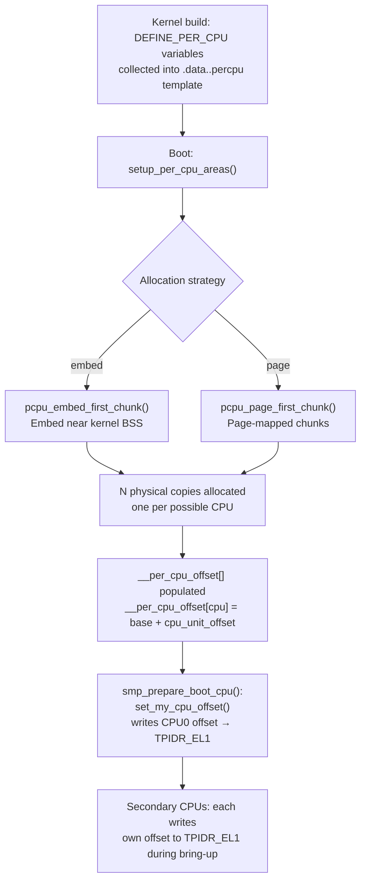
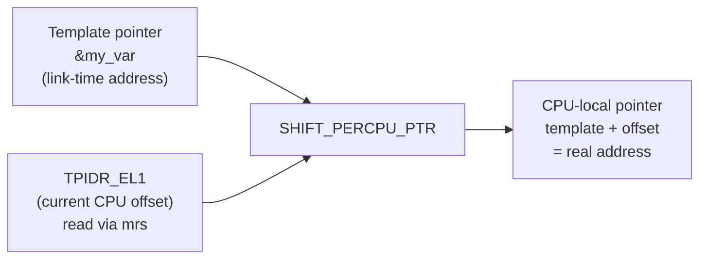
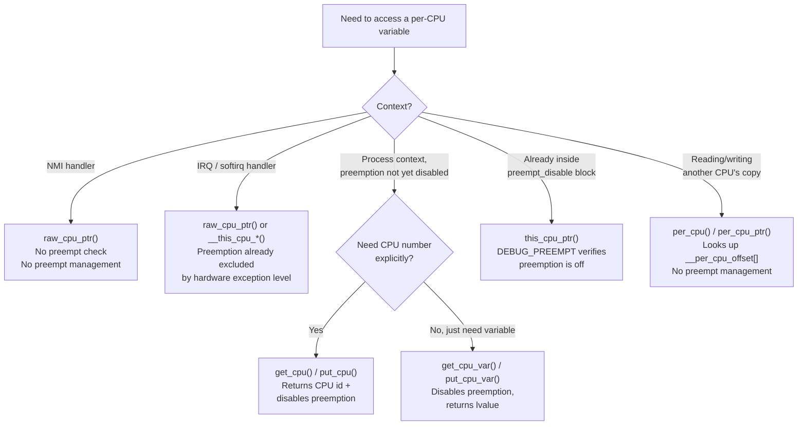
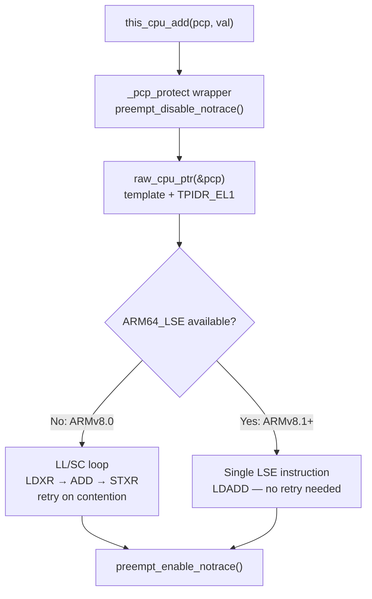
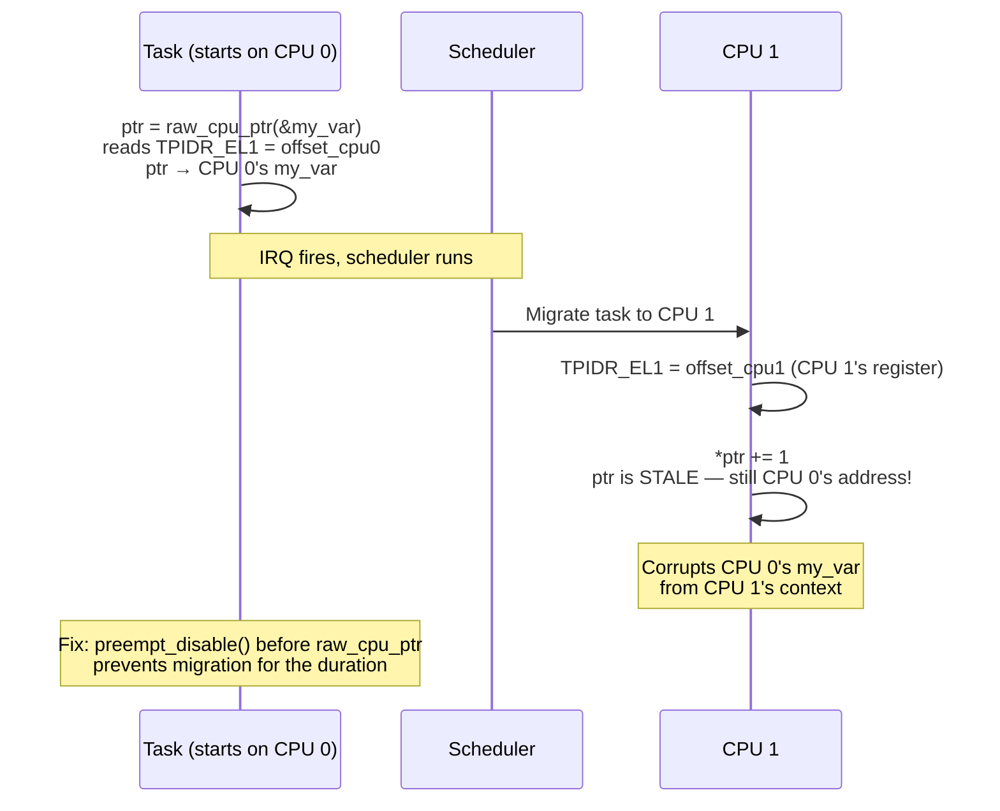

# Per-CPU Variables
On a symmetric multiprocessor system, the instinct is to protect every shared data structure with a lock. Per-CPU variables offer a better answer for a specific and very common case: **data that is logically owned by one CPU at a time. Rather than fighting over a single global copy, the kernel keeps a completely separate instance of the variable for each processor. Each CPU reads and writes only its own copy, so there is no sharing and therefore no need for locks.** The win is twofold: cache performance improves because each CPU's copy fits in its own cache lines without bouncing between cores, and throughput improves because the lock acquire/release overhead disappears entirely. The per-CPU mechanism is the reason the kernel can maintain per-CPU run queues, per-CPU slab magazines, per-CPU network queues, and dozens of other performance-critical data structures without a single lock on the hot path.

## Table of Contents

1. [The Memory Layout](#the-memory-layout)
    - [Same Name, Different Physical Addresses — Different Values per CPU](#same-name-different-physical-addresses--different-values-per-cpu)
2. [AArch64: TPIDR\_EL1 as the Per-CPU Base Register](#aarch64-tpidr_el1-as-the-per-cpu-base-register)
3. [Declaring and Defining Per-CPU Variables](#declaring-and-defining-per-cpu-variables)
4. [Accessing Per-CPU Variables](#accessing-per-cpu-variables)
5. [API Comparison](#api-comparison)
6. [The `this_cpu_*` Operation Family](#the-this_cpu_-operation-family)
7. [Why Preemption Must Be Disabled](#why-preemption-must-be-disabled)
8. [Accessing Another CPU's Copy](#accessing-another-cpus-copy)
9. [Worked Examples from Practice](#worked-examples-from-practice)
10. [Problems and Constraints](#problems-and-constraints)
    - [What Per-CPU Variables Actually Protect — and What They Don't](#what-per-cpu-variables-actually-protect--and-what-they-dont)
    - [Race with an Interrupt Handler (Same CPU)](#race-with-an-interrupt-handler-same-cpu)
    - [Race with a Softirq (Same CPU)](#race-with-a-softirq-same-cpu)
    - [Protection Matrix](#protection-matrix)
    - [NMI Context](#nmi-context)
    - [Sleeping While Holding a Per-CPU Reference](#sleeping-while-holding-a-per-cpu-reference)
    - [NUMA and Remote CPU Access Cost](#numa-and-remote-cpu-access-cost)
    - [Dynamic Allocation and Memory Overhead](#dynamic-allocation-and-memory-overhead)
    - [No Ordering Guarantees Between CPUs](#no-ordering-guarantees-between-cpus)
11. [Real-World AArch64 Per-CPU Variables](#real-world-aarch64-per-cpu-variables)
12. [Memory Layout of a Per-CPU Area](#memory-layout-of-a-per-cpu-area)
13. [Source Reference Summary](#source-reference-summary)

## The Memory Layout

At link time, the compiler gathers all variables declared with `DEFINE_PER_CPU` into a single ELF section named **`.data..percpu`**. This section acts as a **template**: it holds one copy of every per-CPU variable, laid out contiguously, exactly as they would appear for a single CPU.

During boot, `setup_per_cpu_areas()` replicates that template once for each possible CPU and places those copies in physically distinct memory. The following diagram shows the full setup flow, from build time through secondary CPU bring-up:



The result in physical memory looks like this:

```
Physical Memory
───────────────────────────────────────────────────────────────────────
  pcpu_base_addr
  │
  ├─── [ CPU 0 area ]  ← offset[0] from base (often 0)
  │      my_counter: 0
  │      irq_stack_ptr: <ptr>
  │      fpsimd_last_state: { ... }
  │      ...
  │
  ├─── [ CPU 1 area ]  ← offset[1] from base
  │      my_counter: 0
  │      irq_stack_ptr: <ptr>
  │      fpsimd_last_state: { ... }
  │      ...
  │
  ├─── [ CPU 2 area ]  ← offset[2] from base
  │      ...
  │
  └─── [ CPU N area ]  ← offset[N] from base
         ...

  __per_cpu_offset[N] array  (one entry per CPU, maps cpu → byte offset)
───────────────────────────────────────────────────────────────────────
```

The global array **`__per_cpu_offset[NR_CPUS]`** (declared in [/include/asm-generic/percpu.h](https://github.com/torvalds/linux/blob/v7.3-rc7/include/asm-generic/percpu.h#L33-L60)) stores each CPU's byte offset from the base. To reach CPU `n`'s copy of variable `v`, the kernel computes:

```c
addr = (void *)&v + __per_cpu_offset[n];
```

On x86 this requires an array lookup every time. AArch64 eliminates that lookup entirely by caching the current CPU's offset in a dedicated system register.

### Same Name, Different Physical Addresses — Different Values per CPU

`DEFINE_PER_CPU(int, counter)` does not create one `int`. It creates **N separate `int`s**, one per CPU, at N different physical addresses. The variable name `counter` is only a template symbol — at runtime it resolves to a different address depending on which CPU is asking.

```
Symbol name: counter
                │
                ├── CPU 0 → address 0xFFFF_0000_1000  value: 5
                ├── CPU 1 → address 0xFFFF_0010_1000  value: 12
                ├── CPU 2 → address 0xFFFF_0020_1000  value: 0
                └── CPU 3 → address 0xFFFF_0030_1000  value: 99

All named "counter". No shared cache lines. All independent values.
```

This is the entire design goal. Each CPU reads and writes its own copy without touching another CPU's memory. The values diverge naturally as each CPU does its own work — and that divergence is correct and intentional.

The contrast with a plain global variable makes this concrete:

```c
/* Global — one physical address, all CPUs share it */
int global_counter = 0;
/* CPU 0 writes 5, CPU 1 writes 12 simultaneously
   → one store wins, one is silently lost */

/* Per-CPU — N physical addresses, each CPU owns one */
DEFINE_PER_CPU(int, percpu_counter) = 0;
/* CPU 0 writes 5 to its copy  → its copy holds 5
   CPU 1 writes 12 to its copy → its copy holds 12
   Both succeed. No conflict. No lost write.          */
```

On AArch64, the same instruction sequence on every CPU resolves to a different physical address because each CPU's `TPIDR_EL1` holds a different offset value. Same code path, different register content, different destination address — the hardware does the per-CPU routing automatically.

When you need a **system-wide total**, aggregate explicitly:

```c
unsigned long total = 0;
int cpu;

for_each_online_cpu(cpu)
    total += per_cpu(percpu_counter, cpu);  /* reads each CPU's distinct copy */
```

This aggregation is intentionally approximate for statistics — a CPU may update its copy between two iterations of the loop — and that is generally acceptable for counters. For an exact consistent snapshot, you would need to stop each CPU or use a seqlock around the update path.

## AArch64: TPIDR\_EL1 as the Per-CPU Base Register

AArch64 has a spare system register available to the kernel at EL1: **`TPIDR_EL1`** (Thread Pointer ID Register, EL1). The Linux AArch64 port repurposes this register to hold the current CPU's per-CPU offset, turning every per-CPU pointer calculation into a single register read plus an add — no memory access, no array index.

The relevant code lives in [/arch/arm64/include/asm/percpu.h](https://github.com/torvalds/linux/blob/v7.3-rc7/arch/arm64/include/asm/percpu.h):

```c
static inline void set_my_cpu_offset(unsigned long off)
{
    asm volatile(ALTERNATIVE("msr tpidr_el1, %0",
                             "msr tpidr_el2, %0",
                             ARM64_HAS_VIRT_HOST_EXTN)
            :: "r" (off) : "memory");
}

static inline unsigned long __kern_my_cpu_offset(void)
{
    unsigned long off;
    asm(ALTERNATIVE("mrs %0, tpidr_el1",
                    "mrs %0, tpidr_el2",
                    ARM64_HAS_VIRT_HOST_EXTN)
        : "=r" (off) :
        "Q" (*(const unsigned long *)current_stack_pointer));
    return off;
}

#define __my_cpu_offset __kern_my_cpu_offset()
```

`ALTERNATIVE` patches the instruction at boot time: systems running with **VHE** (Virtualization Host Extensions, where the kernel runs at EL2) use `TPIDR_EL2` instead. The `"Q"` constraint on `current_stack_pointer` is a deliberate trick — it creates a fake dependency on the stack, which prevents the compiler from hoisting the `mrs` read above any preceding `barrier()` call without requiring the overhead of `volatile`.

### Boot Initialization

When the boot CPU starts, `smp_prepare_boot_cpu()` ([/arch/arm64/kernel/smp.c#L449](https://github.com/torvalds/linux/blob/v7.3-rc7/arch/arm64/kernel/smp.c#L449-L468)) calls:

```c
set_my_cpu_offset(per_cpu_offset(smp_processor_id()));
```

This writes CPU0's offset into `TPIDR_EL1`. Every secondary CPU does the same during its bring-up sequence, writing its own offset. From that point on, the per-CPU offset for the running CPU is always a single `mrs` away.

### Pointer Arithmetic on AArch64

`arch_raw_cpu_ptr(ptr)` expands to:

```c
SHIFT_PERCPU_PTR(ptr, __my_cpu_offset)
```

which reads `TPIDR_EL1` and adds it to the template pointer. No branch, no memory load, no array index — just a register read and an add.

```
TPIDR_EL1 holds: 0x0001_0000  (CPU 1's offset)

Template pointer of &my_counter: 0xFFFF_8000_0010_0000
                                         ↓
CPU 1's my_counter address:      0xFFFF_8000_0011_0000
                                 = template + TPIDR_EL1
```

The pointer resolution flow is:



## Declaring and Defining Per-CPU Variables

### Static Variables

The two fundamental macros from [/include/linux/percpu-defs.h](https://github.com/torvalds/linux/blob/v7.3-rc7/include/linux/percpu-defs.h) are:

```c
DEFINE_PER_CPU(type, name);     /* define in one translation unit */
DECLARE_PER_CPU(type, name);    /* declare in headers for other TUs */
```

Both place the variable in the `.data..percpu` section using `__attribute__((section(".data..percpu")))`. At runtime, the variable's link-time address is a template offset; adding the per-CPU base offset produces the real address for any given CPU.

A minimal example:

```c
/* Global per-CPU event counter */
DEFINE_PER_CPU(unsigned long, event_count);

static void record_event(void)
{
    this_cpu_inc(event_count);
}
```

### Cache Line Alignment

**`DEFINE_PER_CPU_ALIGNED(type, name)`** adds `____cacheline_aligned` and places the variable in the `..shared_aligned` sub-section. This guarantees the variable starts on a cache line boundary within each CPU's area, which matters when the variable is large enough to otherwise straddle a cache line boundary — straddling would cause two cache lines to be dirtied instead of one. For structures like `struct cpuinfo_arm64` that are read frequently by multiple subsystems, alignment prevents accidental false sharing between adjacent per-CPU variables.

### Hot and Read-Mostly Variants

**`DEFINE_PER_CPU_CACHE_HOT(type, name)`** places the variable in a `..hot..<name>` sub-section, which the linker script groups at the start of each CPU's area. Variables in this section are more likely to be in L1 cache after the first access because they share a hot page with other hot variables. This is used on x86 for things like `current_task` and `__preempt_count`; AArch64 uses it for similar kernel-critical state.

**`DEFINE_PER_CPU_READ_MOSTLY(type, name)`** puts the variable in a `..read_mostly` sub-section. These variables are grouped together so their cache lines are written infrequently and can be kept in a shared (not exclusive) state across all CPUs without invalidation traffic.

### Dynamic Allocation

When the set of per-CPU variables is not known at compile time — for example, in a loadable driver that wants per-CPU state — use dynamic allocation:

```c
unsigned long __percpu *counters;

counters = alloc_percpu(unsigned long);  /* from include/linux/percpu.h */
if (!counters)
    return -ENOMEM;

/* Access */
(*per_cpu_ptr(counters, smp_processor_id()))++;

/* Teardown */
free_percpu(counters);
```

`alloc_percpu(type)` internally calls `pcpu_alloc_noprof()` with `GFP_KERNEL`, which allocates from the percpu allocator's chunk system. The minimum allocation granularity is `PCPU_MIN_ALLOC_SIZE` (4 bytes), and the minimum chunk size is `PCPU_MIN_UNIT_SIZE` (32 KB). The returned pointer carries the `__percpu` address-space qualifier, which sparse uses to catch accidental direct dereferences.

## Accessing Per-CPU Variables

The right accessor depends on context. The following flowchart guides the choice:



### `get_cpu_var` / `put_cpu_var` — The Standard Safe Pattern

```c
get_cpu_var(my_counter)++;
put_cpu_var(my_counter);
```

`get_cpu_var(var)` expands to ([/include/linux/percpu-defs.h#L274](https://github.com/torvalds/linux/blob/v7.3-rc7/include/linux/percpu-defs.h#L274-L288)):

```c
(*({
    preempt_disable();
    this_cpu_ptr(&var);
}))
```

It disables preemption, computes the current CPU's pointer, and returns a dereferenceable lvalue. `put_cpu_var(var)` re-enables preemption. The variable is accessed as if it were a plain local variable while preemption is off, so no spinlock is required. The discipline here is that `get_cpu_var` / `put_cpu_var` must be paired and the section between them must not sleep.

### `get_cpu` / `put_cpu` — CPU ID with Preemption Disabled

```c
int cpu = get_cpu();         /* preempt_disable(); return __smp_processor_id(); */
struct my_state *s = per_cpu_ptr(state_ptr, cpu);
/* ... work with s ... */
put_cpu();                   /* preempt_enable(); */
```

`get_cpu()` from [/include/linux/smp.h#L296](https://github.com/torvalds/linux/blob/v7.3-rc7/include/linux/smp.h#L296-L297) combines disabling preemption and reading the CPU number. It is useful when you need the CPU number explicitly — for example, to pass it to `per_cpu_ptr()` — rather than letting the accessor macro absorb it.

### `this_cpu_ptr` — When You Already Hold Preemption Off

```c
preempt_disable();
struct my_state *s = this_cpu_ptr(&state);
/* ... */
preempt_enable();
```

`this_cpu_ptr(ptr)` ([/include/linux/percpu-defs.h#L246](https://github.com/torvalds/linux/blob/v7.3-rc7/include/linux/percpu-defs.h#L246-L251)) is the same as `raw_cpu_ptr` at runtime in a non-debug build, but when `CONFIG_DEBUG_PREEMPT` is enabled it calls `smp_processor_id()` which will WARN if preemption is not disabled. This makes it the right choice whenever you are managing preemption yourself.

### `raw_cpu_ptr` — Interrupt and NMI Contexts

```c
struct my_state *s = raw_cpu_ptr(&state);
```

`raw_cpu_ptr` skips all preemption checks. On AArch64 it reads `TPIDR_EL1` and adds the offset — nothing else. This is appropriate in interrupt handlers and NMI handlers, where the scheduler cannot run and the CPU cannot migrate, making the pointer guaranteed stable for the duration of the handler.

### `per_cpu` / `per_cpu_ptr` — Cross-CPU Access

```c
/* Read CPU 3's copy of event_count */
unsigned long count = per_cpu(event_count, 3);

/* Write via pointer */
*per_cpu_ptr(&event_count, 3) = 0;
```

`per_cpu_ptr(ptr, cpu)` uses `SHIFT_PERCPU_PTR(ptr, per_cpu_offset(cpu))` — it looks up `__per_cpu_offset[cpu]` in the global array (not TPIDR_EL1) and adds it to the template pointer. There is no preemption management here; the caller must ensure the target CPU does not disappear (typically by holding a reference or iterating under a lock or `cpu_hotplug_begin()`).

### `for_each_online_cpu` — Aggregating Counters

The canonical pattern for summing a per-CPU counter is:

```c
unsigned long total = 0;
int cpu;

for_each_online_cpu(cpu)
    total += per_cpu(event_count, cpu);
```

`for_each_online_cpu` iterates over `cpu_online_mask` ([/include/linux/cpumask.h](https://github.com/torvalds/linux/blob/v7.3-rc7/include/linux/cpumask.h)). The sum is approximate — CPUs may update their counters concurrently — but for statistics that approximation is usually fine. For an exact snapshot, the caller would need to stop each CPU (e.g., via `stop_machine`) or use a seqlock around the counter update.

## API Comparison

```
┌──────────────────────────┬──────────────┬───────────────┬──────────┬──────────────┬──────────────────────────┐
│ Accessor                 │ Manages      │ Preempt       │ NMI      │ Returns      │ Use Case                 │
│                          │ Preemption?  │ Check?        │ Safe?    │ Lvalue?      │                          │
├──────────────────────────┼──────────────┼───────────────┼──────────┼──────────────┼──────────────────────────┤
│ get_cpu_var(var)         │ Yes          │ Built-in      │ No       │ Yes          │ Process context,         │
│ put_cpu_var(var)         │ (dis/enable) │               │          │              │ standard lvalue access   │
├──────────────────────────┼──────────────┼───────────────┼──────────┼──────────────┼──────────────────────────┤
│ get_cpu()                │ Yes          │ Built-in      │ No       │ CPU id (int) │ Need CPU number +        │
│ put_cpu()                │ (dis/enable) │               │          │              │ preempt disable          │
├──────────────────────────┼──────────────┼───────────────┼──────────┼──────────────┼──────────────────────────┤
│ this_cpu_ptr(ptr)        │ Caller must  │ WARN in       │ No       │ Pointer      │ Already under            │
│                          │              │ DEBUG_PREEMPT │          │              │ preempt_disable          │
├──────────────────────────┼──────────────┼───────────────┼──────────┼──────────────┼──────────────────────────┤
│ raw_cpu_ptr(ptr)         │ No           │ None          │ Yes      │ Pointer      │ IRQ / NMI context        │
├──────────────────────────┼──────────────┼───────────────┼──────────┼──────────────┼──────────────────────────┤
│ per_cpu(var, cpu)        │ No           │ None          │ Yes      │ Lvalue       │ Another CPU's copy       │
│ per_cpu_ptr(ptr, cpu)    │              │               │          │ (pointer)    │ (no concurrency guard)   │
└──────────────────────────┴──────────────┴───────────────┴──────────┴──────────────┴──────────────────────────┘
```

## The `this_cpu_*` Operation Family

Beyond simple pointer access, the kernel provides a family of read-modify-write operations that are **CPU-local atomic operations** — atomic in the sense that they cannot be torn by an interrupt on the same CPU, but carrying no ordering or visibility guarantees with respect to other CPUs.

```c
this_cpu_read(pcp)           /* read current CPU's copy */
this_cpu_write(pcp, val)     /* write current CPU's copy */
this_cpu_add(pcp, val)       /* add val to current CPU's copy */
this_cpu_inc(pcp)            /* increment */
this_cpu_dec(pcp)            /* decrement */
this_cpu_add_return(pcp,val) /* add and return new value */
this_cpu_xchg(pcp, val)      /* exchange */
this_cpu_cmpxchg(pcp, o, n)  /* compare-and-exchange */
```

On AArch64, each of these is implemented in [/arch/arm64/include/asm/percpu.h](https://github.com/torvalds/linux/blob/v7.3-rc7/arch/arm64/include/asm/percpu.h) using the `_pcp_protect` / `_pcp_protect_return` wrappers:

```c
#define _pcp_protect(op, pcp, ...)        \
({                                         \
    preempt_disable_notrace();             \
    op(raw_cpu_ptr(&(pcp)), __VA_ARGS__); \
    preempt_enable_notrace();             \
})
```

The underlying read-modify-write uses either the **LL/SC** (`LDXR` / `STXR`) loop or the **LSE atomic** variant (`LDADD`, `LDCLR`, `LDSET`) selected at runtime via `ARM64_LSE_ATOMIC_INSN`. For example, `this_cpu_add_4` ends up calling `__percpu_add_case_32`, which looks like:

```asm
1:  ldxr   w[tmp], [ptr]
    add    w[tmp], w[tmp], w[val]
    stxr   w[loop], w[tmp], [ptr]
    cbnz   w[loop], 1b

/* OR with LSE: */
    ldadd  w[val], w[tmp], [ptr]
```

The implementation flow from `this_cpu_add` down to the hardware instruction is:



The LL/SC loop is the fallback for all ARMv8 cores; LSE is preferred on ARMv8.1+ because it avoids the retry loop and has better microarchitectural properties on many cores.

### Three Levels of Per-CPU RMW

The `this_cpu_*`, `__this_cpu_*`, and `raw_cpu_*` families differ only in what protection they assume:

- **`this_cpu_add(pcp, val)`** — wraps preempt_disable/enable around the operation. Safe to call anywhere preemption can be disabled (process context, softirq, hardirq).
- **`__this_cpu_add(pcp, val)`** — no preemption management. In debug builds it asserts preemption is off. Use inside a spinlock, interrupt handler, or between explicit `preempt_disable()` / `preempt_enable()` calls.
- **`raw_cpu_add(pcp, val)`** — no checks at all. Use in NMI handlers where neither preemption nor locking is possible.

```
Three-Level RMW Comparison
──────────────────────────────────────────────────────────────────────────
  Family          Preempt Mgmt   Preempt Check        Typical Context
  ─────────────── ──────────── ─────────────────────── ───────────────────
  this_cpu_*      Disables +   None (implicit via      Process context,
                  re-enables   preempt_disable)         softirq, hardirq

  __this_cpu_*    None         Asserts off in          Inside spinlock,
                               DEBUG_PREEMPT           interrupt handler,
                               (WARN if not)           between explicit
                                                        preempt_disable /
                                                        preempt_enable

  raw_cpu_*       None         None                    NMI handler
──────────────────────────────────────────────────────────────────────────
```

## Why Preemption Must Be Disabled

The per-CPU model depends on the invariant that a task does not migrate to another CPU while it is using a per-CPU variable. Without preemption disabled, migration can happen between any two instructions:

```
CPU 0                              CPU 1
────────────────────────────       ────────────────────────────
ptr = raw_cpu_ptr(&my_var);
                                   ← scheduler migrates task here
                                   ptr still points to CPU 0's copy
*ptr += 1;                         ← modifies CPU 0's copy
                                      from CPU 1's execution context
```

The migrated task is now running on CPU 1 but writing to CPU 0's instance of `my_var`. This is exactly what per-CPU variables are designed to prevent — but the prevention only works if the task cannot migrate.

The following sequence diagram shows the hazard in detail:



```
Hazard: Task migrates between TPIDR_EL1 read and pointer dereference
──────────────────────────────────────────────────────────────────────

 Step 1:  TPIDR_EL1 = offset_cpu0
          ptr = template + TPIDR_EL1  →  CPU0's my_var

 Step 2:  IRQ fires, scheduler runs, task migrates to CPU1

 Step 3:  Task resumes on CPU1
          TPIDR_EL1 now = offset_cpu1  (but ptr is stale!)
          *ptr += 1  →  corrupts CPU0's my_var from CPU1

Fix: preempt_disable() before Step 1, preempt_enable() after Step 3
──────────────────────────────────────────────────────────────────────
```

Interrupt handlers and NMI handlers are safe without explicit preemption disabling because the scheduler cannot preempt an interrupt handler on AArch64 — exceptions are taken at higher priority and the hardware prevents re-entry. `raw_cpu_ptr` is therefore correct in those contexts.

## Accessing Another CPU's Copy

Sometimes the goal is not to update the current CPU's data but to read or reset another CPU's. The `per_cpu()` and `per_cpu_ptr()` accessors look up the target CPU's offset from `__per_cpu_offset[]` rather than from `TPIDR_EL1`:

```c
unsigned long total = 0;
int cpu;

for_each_online_cpu(cpu)
    total += per_cpu(event_count, cpu);

pr_info("total events: %lu\n", total);
```

Crucially, `per_cpu()` provides **no locking**. The target CPU may be modifying its copy concurrently. For simple counters that tolerate approximate reads this is fine — the Linux networking and block layer statistics work exactly this way. For anything requiring a consistent view, the caller must coordinate with the target CPU through an explicit lock, a stop-machine sequence, or by reading with `READ_ONCE()` and accepting that the value may be mid-update.

On **NUMA** systems, accessing a remote CPU's per-CPU area crosses a NUMA node boundary. The access itself works correctly, but it brings the cache line into the accessing CPU's cache with a coherence miss. In tight loops over all CPUs this can become expensive; the pattern is usually acceptable for infrequent administrative paths (proc reads, stats collection) but should be avoided in fast paths.

## Worked Examples from Practice

The following five examples form a teaching progression, each one building on the previous to introduce a new concept. They come from `day15/10_percpu/` in this repository.

### Example 1 — The Naive Array (What Not To Do)

Before `DEFINE_PER_CPU` existed, a common pattern was a plain global array indexed by CPU number. The example creates a `/proc/percpu` entry that writes a value to the current CPU's slot and reads all slots on display:

```c
#include <linux/module.h>
#include <linux/proc_fs.h>
#include <linux/seq_file.h>
#include <linux/uaccess.h>

MODULE_LICENSE("GPL");

static struct proc_dir_entry *file_pde;
unsigned int percpu_data[NR_CPUS];

static int cpu_show(struct seq_file *m, void *v)
{
    int i;
    for (i = 0; i < num_online_cpus(); i++)
        seq_printf(m, "Processor %d: %u\n", i, percpu_data[i]);
    return 0;
}

static ssize_t proc_write_cpu(struct file *file, const char *buffer,
                               size_t count, loff_t *data)
{
    unsigned char buf[10];
    unsigned int user_val;
    int cpu;

    if (copy_from_user(buf, buffer, count))
        return -EFAULT;

    buf[count] = '\0';
    user_val = simple_strtoul(buf, NULL, 10);

    cpu = get_cpu();                          /* disable preemption, get CPU id */
    percpu_data[cpu] = user_val;
    printk("percpu_data on cpu=%d is %u\n", cpu, percpu_data[cpu]);
    put_cpu();                                /* re-enable preemption */

    return count;
}
```

`unsigned int percpu_data[NR_CPUS]` is a plain global array. Its per-element semantics depend entirely on disciplined indexing — nothing in the type system prevents CPU 1 from writing to `percpu_data[0]`. More importantly, all CPU slots live in the same contiguous memory region: on a write-heavy workload the cache line containing CPU 0's slot and CPU 1's slot ping-pongs between cores, causing exactly the cache-line bouncing that per-CPU variables were designed to eliminate. The modern `DEFINE_PER_CPU` approach places each CPU's copy in a separate, cacheline-aligned region, removing that bouncing. Notice that `get_cpu()`/`put_cpu()` is still necessary even with the naive array — without it, the task could be preempted and migrated to another CPU between reading the CPU id and writing to the slot, corrupting the wrong CPU's data.

### Example 2 — Static `DEFINE_PER_CPU` with `get_cpu_var` / `put_cpu_var`

This is the canonical way to declare and access a per-CPU variable at compile time:

```c
#include <linux/module.h>
#include <linux/percpu.h>

MODULE_LICENSE("GPL");

static DEFINE_PER_CPU(long, percpuvar) = 5;

static int __init test_hello_init(void)
{
    int cpu;

    /* get_cpu_var: disables preemption, returns lvalue for current CPU's copy */
    pr_info("percpuvar = %ld\n", get_cpu_var(percpuvar)++);
    cpu = smp_processor_id();
    printk("current cpu = %d\n", cpu);
    put_cpu_var(percpuvar);   /* re-enable preemption */

    pr_info("percpuvar = %ld\n", get_cpu_var(percpuvar));
    cpu = smp_processor_id();
    printk("current cpu = %d\n", cpu);
    put_cpu_var(percpuvar);

    return -1;
}

module_init(test_hello_init);
module_exit(test_hello_exit);
```

`DEFINE_PER_CPU(long, percpuvar) = 5` creates one `long` initialized to 5 for every possible CPU, all placed in the `.data..percpu` template section. `get_cpu_var(percpuvar)++` is equivalent to `(*this_cpu_ptr(&percpuvar))++` — preemption is disabled for the entire get/put block, so the increment is safe with respect to task migration. `smp_processor_id()` inside the get/put block is safe precisely because preemption is off and the task cannot be moved.

An **lvalue** is an expression with an identifiable memory address. `get_cpu_var` returns an lvalue, meaning you can assign to it directly (`get_cpu_var(x) = 42`) or take its address, unlike a temporary expression like `(x + 1)` which produces a value with no addressable location. This is why the macro name uses `var` — it behaves like a variable, not like a function call returning a copy.

### Example 3 — `per_cpu()` for Cross-CPU Reads

When aggregating statistics or inspecting another CPU's state, use `per_cpu(var, cpu)` to reach across CPU boundaries:

```c
#include <linux/module.h>
#include <linux/percpu.h>

MODULE_LICENSE("GPL");

DEFINE_PER_CPU(int, counter);

static int __init test_hello_init(void)
{
    int num_cpus = num_online_cpus();
    int i;

    pr_info("Number of CPUs online: %d\n", num_cpus);

    /* Read each CPU's counter before any update */
    for (i = 0; i < num_cpus; i++)
        pr_info("counter[cpu=%d] = %d\n", i, per_cpu(counter, i));

    /* Update the current CPU's copy */
    get_cpu_var(counter) = 10;
    pr_info("Updated CPU %d's counter\n", smp_processor_id());
    put_cpu_var(counter);

    /* Read all CPUs again — only the current CPU's copy changed */
    for (i = 0; i < num_cpus; i++)
        pr_info("counter[cpu=%d] = %d\n", i, per_cpu(counter, i));

    return -1;
}

module_init(test_hello_init);
module_exit(test_hello_exit);
```

`per_cpu(counter, i)` looks up CPU `i`'s copy of `counter` via the `__per_cpu_offset[i]` array. On AArch64 this is distinct from the TPIDR_EL1 fast path used by `this_cpu_ptr` — it always goes through the offset array regardless of which CPU is running the code. The value read may be stale by the time `pr_info` executes, because CPU `i` could update its copy concurrently. For read-only statistics collection this approximation is acceptable; for anything requiring a precise snapshot, a stop-machine or per-CPU lock would be needed.

### Example 4 — `for_each_online_cpu` Iteration

`for_each_online_cpu` is the idiomatic way to iterate over all active CPUs without a hard-coded upper bound:

```c
#include <linux/module.h>
#include <linux/percpu.h>

MODULE_LICENSE("GPL");

DEFINE_PER_CPU(int, counter);

static int __init test_hello_init(void)
{
    int i;

    for_each_online_cpu(i)
        pr_info("counter[cpu=%d] = %d\n", i, per_cpu(counter, i));

    get_cpu_var(counter) = 10;
    pr_info("Updated CPU %d\n", smp_processor_id());
    put_cpu_var(counter);

    for_each_online_cpu(i)
        pr_info("counter[cpu=%d] = %d\n", i, per_cpu(counter, i));

    return -1;
}

module_init(test_hello_init);
module_exit(test_hello_exit);
```

`for_each_online_cpu(i)` iterates over `cpu_online_mask`, which reflects CPUs that have been brought online and not yet hotplugged out. It is preferable to a `for (i = 0; i < num_online_cpus(); i++)` loop because `num_online_cpus()` returns a count, while the actual online set may have gaps — if CPU 0 and CPU 2 are online but CPU 1 was hotplugged out, the count is 2 but the valid indices are 0 and 2. `for_each_online_cpu` handles sparse CPU sets correctly; the naive index loop does not.

### Example 5 — Dynamic Allocation with `alloc_percpu`

When the set of per-CPU variables is not known at compile time — a loadable driver that needs per-CPU private state — use dynamic allocation:

```c
#include <linux/module.h>
#include <linux/percpu.h>

MODULE_LICENSE("GPL");

static int __percpu *dynamic_counter;

static int __init test_hello_init(void)
{
    int cpu;
    int i;

    dynamic_counter = alloc_percpu(int);
    if (!dynamic_counter)
        return -ENOMEM;

    cpu = get_cpu();
    *per_cpu_ptr(dynamic_counter, cpu) = 1000;
    put_cpu();

    for (i = 0; i < num_online_cpus(); i++)
        pr_info("cpu:%d\tcounter:%d\n", i, *per_cpu_ptr(dynamic_counter, i));

    free_percpu(dynamic_counter);
    return -1;
}

module_init(test_hello_init);
module_exit(test_hello_exit);
```

`alloc_percpu(int)` allocates one `int` per possible CPU from the percpu allocator and returns a `__percpu`-qualified pointer. The `__percpu` qualifier is a sparse annotation — it prevents direct dereference and forces the programmer to use `per_cpu_ptr()` or `this_cpu_ptr()` to obtain a real kernel pointer. `per_cpu_ptr(dynamic_counter, cpu)` returns a pointer to the requested CPU's copy; dereferencing it yields the value. `free_percpu()` frees all copies in one call. From the caller's perspective this is identical to working with a `DEFINE_PER_CPU` variable; the only difference is lifetime management — the caller is responsible for allocation and deallocation, which is essential for module teardown.

## Problems and Constraints

### What Per-CPU Variables Actually Protect — and What They Don't

The central guarantee that per-CPU variables provide is narrow and must be understood precisely: **they eliminate races between different CPUs accessing the same data**. Each CPU owns its own copy of the variable, so two CPUs can write to their respective copies simultaneously without any coherency problem — there is nothing to conflict over because they are writing to physically distinct memory locations.

That guarantee covers exactly one threat: **true SMP parallelism**. It covers nothing else.

```
What per-CPU isolation protects against:
──────────────────────────────────────────────────────────────────────────
  CPU 0              CPU 1              CPU 2

  my_var[0]          my_var[1]          my_var[2]
  ┌────────┐         ┌────────┐         ┌────────┐
  │  val=5 │         │  val=3 │         │  val=9 │
  └────────┘         └────────┘         └────────┘
      ▲                   ▲                  ▲
      │ only CPU 0        │ only CPU 1       │ only CPU 2
      │ writes here       │ writes here      │ writes here

  → No cross-CPU race. Each CPU is sovereign over its own copy.

What per-CPU isolation does NOT protect against (same CPU, different context):
──────────────────────────────────────────────────────────────────────────
  CPU 0 process context    CPU 0 IRQ handler    CPU 0 softirq    CPU 0 NMI
  ──────────────────────   ─────────────────    ─────────────    ─────────
          ↓                        ↓                  ↓              ↓
                     all access the SAME my_var[0]
                     → race possible between any two of them
```

The same physical memory location — CPU 0's copy of the variable — is accessed by process context, IRQ handlers, softirq handlers, and NMI handlers all running on CPU 0. **Per-CPU isolation cannot help here because the conflict is not between CPUs; it is between execution contexts on the same CPU.**

### Race with an Interrupt Handler (Same CPU)

If process context and an interrupt handler on the same CPU both access the same per-CPU variable, a race exists even though preemption is disabled:

```c
/* WRONG: process context and IRQ handler share this variable */
DEFINE_PER_CPU(int, shared_with_irq);

/* Process context — preempt_disable() does NOT block IRQs */
int val = get_cpu_var(shared_with_irq);  /* preempt disabled, IRQ can still fire */
val++;
get_cpu_var(shared_with_irq) = val;      /* 3-step read-modify-write, not atomic */
put_cpu_var(shared_with_irq);

/* IRQ handler — runs on same CPU, interrupts the sequence above */
__this_cpu_inc(shared_with_irq);
```

The race unfolds as:

```
Same-CPU IRQ Race
──────────────────────────────────────────────────────────────────────────
  Process context (CPU 0)        IRQ handler (CPU 0)
  ───────────────────────        ───────────────────
  val = *ptr          (reads 5)
                                 ← IRQ fires here
                                 __this_cpu_inc → *ptr = 6
                                 ← IRQ returns
  val++ → val = 6
  *ptr = val          (writes 6) ← LOST the IRQ's increment!
  Result: 6, expected 7
──────────────────────────────────────────────────────────────────────────
```

**`preempt_disable()` only prevents the scheduler from replacing the current task. It has no effect on hardware interrupts,** which arrive asynchronously via the GIC and are gated by `PSTATE.DAIF`, not by `preempt_count`.

The fix is either to disable IRQs for the duration of the process-context access, or to use a single-instruction atomic operation:

```c
/* Fix 1: disable IRQs around the read-modify-write */
unsigned long flags;
local_irq_save(flags);
__this_cpu_inc(shared_with_irq);   /* now safe: IRQ handler cannot interrupt */
local_irq_restore(flags);

/* Fix 2: use a single atomic per-CPU op — no explicit IRQ management needed */
this_cpu_inc(shared_with_irq);     /* _pcp_protect wraps preempt_disable only,
                                      but the LL/SC or LSE atomic makes it
                                      interrupt-safe at the hardware level */
```

### Race with a Softirq (Same CPU)

Softirqs (and tasklets, which are built on softirqs) run in a software interrupt context that is distinct from both hard-IRQ context and process context. A process-context path can be interrupted by a softirq on the same CPU even when preemption is disabled, unless softirq processing is explicitly deferred:

```c
DEFINE_PER_CPU(struct stats, net_stats);

/* Process context — updating stats */
struct stats *s = &get_cpu_var(net_stats);
s->rx_packets++;          /* softirq can fire between these two lines */
s->rx_bytes += len;
put_cpu_var(net_stats);

/* Net RX softirq — also updates net_stats on same CPU */
__this_cpu_add(net_stats.rx_bytes, skb->len);
```

The fix is `local_bh_disable()` / `local_bh_enable()`, which defer softirq processing to after the critical region. Unlike `local_irq_disable()`, this does not mask hardware interrupts — it only prevents the softirq daemon from running on the current CPU:

```c
local_bh_disable();
__this_cpu_inc(net_stats.rx_packets);
__this_cpu_add(net_stats.rx_bytes, len);
local_bh_enable();
```

### Protection Matrix

The table below summarises which threats each approach eliminates on AArch64:

```
                           │ Other CPU  │ Same-CPU   │ Same-CPU   │ Same-CPU
Protection mechanism       │ (SMP race) │ task sched │ IRQ handler│ softirq
───────────────────────────┼────────────┼────────────┼────────────┼──────────
per-CPU variable alone     │     ✓      │     ✓ *    │     ✗      │     ✗
+ preempt_disable          │     ✗      │     ✓      │     ✗      │     ✗
+ local_irq_disable        │     ✗      │     ✓      │     ✓      │     ✓
+ local_bh_disable         │     ✗      │     ✓      │     ✗      │     ✓
spinlock (spin_lock)       │     ✓      │     ✓      │     ✗      │     ✗
spin_lock_irqsave          │     ✓      │     ✓      │     ✓      │     ✓
spin_lock_bh               │     ✓      │     ✓      │     ✗      │     ✓
───────────────────────────┴────────────┴────────────┴────────────┴──────────
* per-CPU alone protects from other tasks only if preemption keeps them off
  the same CPU slot — not a strong guarantee without explicit preempt_disable
```

The practical rule: per-CPU variables handle the SMP axis; `local_irq_save` or `local_bh_disable` handle the same-CPU asynchronous-context axis. The two are orthogonal and often combined.

### NMI Context

**Non-Maskable Interrupt** (NMI) — implemented on AArch64 via GIC Pseudo-NMI at a higher priority level than regular IRQs — presents the strictest constraints. A NMI can fire even when `local_irq_disable()` has masked ordinary interrupts, so `local_irq_save` does not protect against NMI handlers.

More subtly, `get_cpu_var()` itself is unsafe in NMI context: it calls `preempt_disable()`, which increments `preempt_count`, which is itself a per-CPU variable accessed via a `this_cpu_*` write. If `get_cpu_var` is called from within an NMI that interrupted another `get_cpu_var` call — a scenario that can happen with nested pseudo-NMIs — `preempt_count` can be corrupted.

NMI handlers must use `raw_cpu_ptr()` and the `raw_cpu_*` family of operations exclusively:

```c
/* NMI handler — safe */
struct my_state *s = raw_cpu_ptr(&my_state);   /* reads TPIDR_EL1, no preempt_count touch */
raw_cpu_inc(my_counter);                        /* no preempt check, no preempt_disable */

/* NMI handler — WRONG */
struct my_state *s = &get_cpu_var(my_state);   /* calls preempt_disable → unsafe in NMI */
```

The `nmi_contexts` per-CPU variable in `arch/arm64/kernel/irq.c` is accessed exactly this way — it uses `raw_cpu_ptr` in the NMI entry path because that is the only safe accessor at that level.

### Sleeping While Holding a Per-CPU Reference

`get_cpu_var()` disables preemption. Any call to a blocking function — `schedule()`, `msleep()`, `mutex_lock()`, `wait_event()`, `copy_from_user()` — while preemption is disabled triggers either a kernel panic (in debug builds) or a deadlock. The scheduler cannot run, so the blocking call can never complete.

```c
/* WRONG — will deadlock or BUG() */
get_cpu_var(my_state).count++;
msleep(100);                    /* tries to sleep with preemption disabled */
put_cpu_var(my_state);

/* Correct — complete the per-CPU access, then sleep */
get_cpu_var(my_state).count++;
put_cpu_var(my_state);
msleep(100);
```

### NUMA and Remote CPU Access Cost

On NUMA systems, `per_cpu(var, remote_cpu)` reads a value from a memory node that may not be local to the accessing CPU. The access itself is correct — the coherency fabric handles it — but it brings the cache line across a NUMA interconnect, which is far slower than a local cache hit. In tight loops over all CPUs (such as statistics aggregation in a proc read), this remote access cost accumulates. It is acceptable for infrequent administrative paths but should be avoided in hot paths.

### Dynamic Allocation and Memory Overhead

`alloc_percpu(type)` allocates one copy of `type` for every **possible** CPU (`NR_CPUS` at compile time, bounded by `nr_cpu_ids` at runtime), not just online CPUs. On systems where `NR_CPUS` is large (e.g., 256 for a distro kernel) but few CPUs are online, the allocation wastes memory for offline slots. For structures larger than a few bytes, this overhead is worth considering before choosing dynamic per-CPU allocation over a global structure.

### No Ordering Guarantees Between CPUs

Per-CPU variables carry no cross-CPU memory ordering. A store to CPU 0's copy of `var` is immediately visible to CPU 0, but CPU 1 reading its own copy sees an entirely different physical location — there is nothing to order. If the intent is to *signal* another CPU (rather than maintain independent per-CPU state), per-CPU variables are the wrong tool; explicit memory barriers and shared atomic variables or locking are required.

### Problems and Constraints Summary

| Problem | Root Cause | Fix |
|---|---|---|
| Race with IRQ handler (same CPU) | `preempt_disable` does not mask hardware interrupts; IRQ can fire mid read-modify-write | `local_irq_save` / `local_irq_restore`, or single-instruction `this_cpu_inc` |
| Race with softirq (same CPU) | Softirq runs between two `__this_cpu_*` operations even with preemption disabled | `local_bh_disable` / `local_bh_enable` around the update |
| Race with NMI (same CPU) | NMI fires through `local_irq_disable`; `get_cpu_var` itself calls `preempt_disable`, corrupting `preempt_count` if nested | Use `raw_cpu_ptr` and `raw_cpu_*` exclusively inside NMI handlers |
| Sleeping inside `get_cpu_var` | `get_cpu_var` disables preemption; scheduler cannot run while preemption is off | Release with `put_cpu_var` before any blocking call |
| Cross-CPU race on same slot | Two CPUs accessing one CPU's slot via `per_cpu(var, n)` with no lock | Caller must hold a lock or use `stop_machine` if consistent cross-CPU update is required |
| NUMA remote access overhead | `per_cpu(var, remote_cpu)` crosses NUMA interconnect — correct but slow | Use only on infrequent paths (proc reads, stats); avoid in hot paths |
| Memory waste from `alloc_percpu` | Allocates for `NR_CPUS` possible slots, not just online CPUs | Acceptable for small types; reconsider for large structs on high-`NR_CPUS` builds |
| No cross-CPU ordering | Different CPUs write to physically distinct addresses; no ordering implied | Use explicit barriers + shared atomics or locking when signalling between CPUs |
| `per_cpu` stale read | Target CPU may update its copy concurrently with the read | Use `READ_ONCE`, accept approximate reads for stats, or coordinate with `stop_machine` for exact snapshots |

## Real-World AArch64 Per-CPU Variables

### IRQ Stack (`irq_stack_ptr`)

```c
DEFINE_PER_CPU(unsigned long *, irq_stack_ptr);
```

([/arch/arm64/kernel/irq.c#L34](https://github.com/torvalds/linux/blob/v7.3-rc7/arch/arm64/kernel/irq.c#L31-L73))

Each CPU has a dedicated interrupt stack separate from the task's kernel stack. `init_irq_stacks()` allocates `IRQ_STACK_SIZE` bytes per possible CPU using `arch_alloc_vmap_stack()` — a vmalloc-backed virtually mapped stack that provides a guard page. The pointer to each CPU's stack is stored as a per-CPU variable. When an interrupt fires on AArch64, the kernel entry code reads `irq_stack_ptr` via `raw_cpu_ptr` to switch to the interrupt stack before dispatching the handler. This ensures that even deeply nested function calls inside a handler cannot overflow the task's kernel stack.

### FPSIMD State (`fpsimd_last_state`)

```c
DEFINE_PER_CPU(struct cpu_fp_state, fpsimd_last_state);
```

([/arch/arm64/kernel/fpsimd.c#L124](https://github.com/torvalds/linux/blob/v7.3-rc7/arch/arm64/kernel/fpsimd.c#L124))

AArch64's FPSIMD registers (32 × 128-bit `V0`–`V31`) are expensive to save and restore. The kernel uses lazy context switching: FPSIMD state is only saved when a different task needs the registers. `fpsimd_last_state` tracks which task's state is currently loaded in each CPU's FPSIMD registers. On a context switch, the kernel checks whether the incoming task is the one whose state is already live in the registers — if so, no save or restore is needed. This per-CPU variable is the key to making that check O(1) without any lock.

### Entry Task (`__entry_task`)

```c
DEFINE_PER_CPU(struct task_struct *, __entry_task);
```

([/arch/arm64/kernel/process.c#L574](https://github.com/torvalds/linux/blob/v7.3-rc7/arch/arm64/kernel/process.c#L574))

When a task enters the kernel from EL0 (user space), the kernel needs a fast way to recover the `task_struct` pointer in the entry assembly path before it has set up a full kernel context. `__entry_task` is updated during the context switch so the entry path can always find the current task via a single per-CPU load.

### CPU Feature Data (`cpu_data`)

```c
DEFINE_PER_CPU(struct cpuinfo_arm64, cpu_data);
```

([/arch/arm64/kernel/cpuinfo.c#L33](https://github.com/torvalds/linux/blob/v7.3-rc7/arch/arm64/kernel/cpuinfo.c#L33))

On heterogeneous AArch64 systems (big.LITTLE, DynamIQ), different CPU clusters may have different feature register values. `struct cpuinfo_arm64` stores the ID registers read from one specific CPU. By making this a per-CPU variable, the kernel can correctly report each CPU's individual capabilities without locking or cross-CPU reads when checking feature support in the execution path.

### NMI Context (`nmi_contexts`)

```c
DEFINE_PER_CPU(struct nmi_ctx, nmi_contexts);
```

([/arch/arm64/kernel/irq.c#L32](https://github.com/torvalds/linux/blob/v7.3-rc7/arch/arm64/kernel/irq.c#L31-L73))

NMI (Non-Maskable Interrupt) handling on AArch64 (via `GIC_CPU_PMR` or hardware Pseudo-NMI) requires per-CPU state to track nesting and to save/restore context. `nmi_contexts` is accessed exclusively via `raw_cpu_ptr` in the NMI entry path — the only safe accessor when preemption management itself is unavailable.

## Memory Layout of a Per-CPU Area

The linker script (via `PERCPU_INPUT` in [/include/asm-generic/vmlinux.lds.h](https://github.com/torvalds/linux/blob/v7.3-rc7/include/asm-generic/vmlinux.lds.h)) organizes the per-CPU section into sub-sections:

```
Per-CPU Unit Layout (one copy per CPU)
──────────────────────────────────────────────────────
  __per_cpu_start
  │
  ├── [ ..hot..* ]         ← DEFINE_PER_CPU_CACHE_HOT
  │     (hot variables grouped for L1 locality)
  │
  ├── [ .data..percpu ]    ← DEFINE_PER_CPU (default)
  │     event_count
  │     my_driver_state
  │     ...
  │
  ├── [ ..shared_aligned ] ← DEFINE_PER_CPU_ALIGNED
  │     cpuinfo_arm64
  │     (cacheline-aligned, no false sharing)
  │
  ├── [ ..read_mostly ]    ← DEFINE_PER_CPU_READ_MOSTLY
  │     (rarely written, shared cache state preferred)
  │
  └── [ ..page_aligned ]   ← DEFINE_PER_CPU_PAGE_ALIGNED
        (full-page allocations, e.g., stacks)
  __per_cpu_end
──────────────────────────────────────────────────────
```

Each CPU's area is a verbatim copy of this layout at a different physical address, separated by `__per_cpu_offset[cpu]` from the template base.

## Source Reference Summary

| File | Line(s) | Purpose |
|------|---------|---------|
| [/arch/arm64/include/asm/percpu.h](https://github.com/torvalds/linux/blob/v7.3-rc7/arch/arm64/include/asm/percpu.h) | 15–53 | TPIDR_EL1 read/write, AArch64 `this_cpu_*` impls |
| [/include/linux/percpu-defs.h](https://github.com/torvalds/linux/blob/v7.3-rc7/include/linux/percpu-defs.h) | 105–300 | `DEFINE_PER_CPU`, `get_cpu_var`, `this_cpu_ptr`, etc. |
| [/include/asm-generic/percpu.h](https://github.com/torvalds/linux/blob/v7.3-rc7/include/asm-generic/percpu.h#L33-L60) | 33–60 | `__per_cpu_offset[]`, `per_cpu_offset()`, `arch_raw_cpu_ptr` |
| [/include/linux/percpu.h](https://github.com/torvalds/linux/blob/v7.3-rc7/include/linux/percpu.h) | 150–157 | `alloc_percpu`, `free_percpu` |
| [/include/linux/smp.h](https://github.com/torvalds/linux/blob/v7.3-rc7/include/linux/smp.h#L296-L297) | 296–297 | `get_cpu()`, `put_cpu()` |
| [/include/linux/cpumask.h](https://github.com/torvalds/linux/blob/v7.3-rc7/include/linux/cpumask.h) | — | `for_each_online_cpu`, `for_each_possible_cpu` |
| [/include/asm-generic/vmlinux.lds.h](https://github.com/torvalds/linux/blob/v7.3-rc7/include/asm-generic/vmlinux.lds.h) | 1093–1130 | `PERCPU_INPUT` linker section layout |
| [/arch/arm64/kernel/smp.c](https://github.com/torvalds/linux/blob/v7.3-rc7/arch/arm64/kernel/smp.c#L449-L468) | 449–468 | `smp_prepare_boot_cpu` → `set_my_cpu_offset` |
| [/arch/arm64/kernel/irq.c](https://github.com/torvalds/linux/blob/v7.3-rc7/arch/arm64/kernel/irq.c#L31-L73) | 31–73 | `irq_stack_ptr`, `nmi_contexts`, `init_irq_stacks` |
| [/arch/arm64/kernel/fpsimd.c](https://github.com/torvalds/linux/blob/v7.3-rc7/arch/arm64/kernel/fpsimd.c#L124) | 124 | `fpsimd_last_state` lazy FPSIMD switching |
| [/arch/arm64/kernel/process.c](https://github.com/torvalds/linux/blob/v7.3-rc7/arch/arm64/kernel/process.c#L574) | 574 | `__entry_task` |
| [/arch/arm64/kernel/cpuinfo.c](https://github.com/torvalds/linux/blob/v7.3-rc7/arch/arm64/kernel/cpuinfo.c#L33) | 33 | `cpu_data` per-CPU CPU features |
